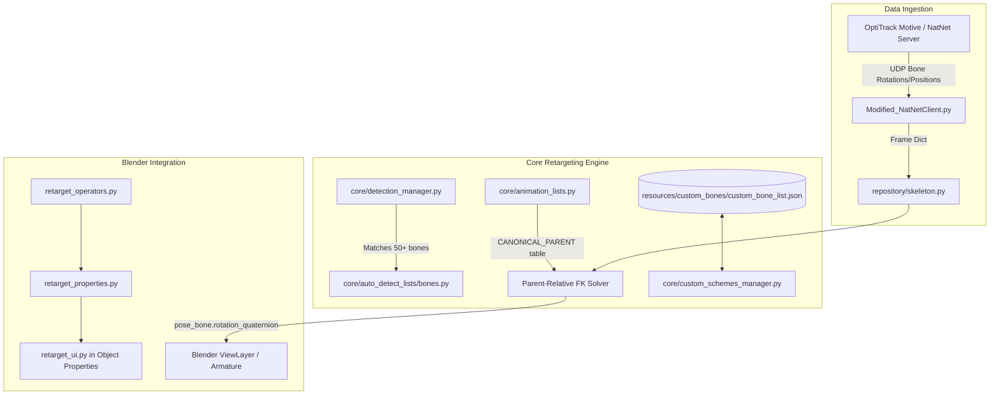

# Technical Specification & Architecture: Real-Time Motion Capture Retargeting for Custom Humanoid Armatures in Blender

**Author:** OptiTrack Blender Integration Team  
**Target Audience:** Academic Evaluators, Research Supervisors, OptiTrack Core Integration Engineers  
**Component:** `optitrack-blender` Add-on for Blender 4.x / 5.x  
**Feature:** Live Hierarchical Retargeting System for Arbitrary Humanoid Skeletons  

---

## 1. Executive Summary

This document presents the architecture, mathematical foundation, and implementation details of the real-time motion capture retargeting pipeline integrated into the **OptiTrack Motive Blender Addon**. 

Historically, live streaming from OptiTrack Motive into Blender was restricted to native Motive armature templates created via the `Add Motive Armature` operator. Attempting to drive third-party or production-standard rigs (e.g., Mixamo, Unreal Engine Mannequin, Daz3D, Rigify) resulted in severe kinematic abnormalities:
1. **Compound rotation explosions:** Lifting a thigh caused the child tibia/shin to kick out horizontally into the air.
2. **Torso spiral artifacts:** Slight body yaw caused cumulative rotational winding along the spine chain, violently twisting the torso and dragging the arms across the chest in a self-hugging pose.
3. **Operational rigidity:** Calibration required manual, in-situ pose capturing ("Set as T-Pose"), creating severe friction for solo mocap performers who operate both the capture volume and the workstation.

To resolve these defects, we engineered a modular, production-ready retargeting subsystem adapted from the industry-proven **Rokoko Studio Live** architecture, enhanced with a novel **Parent-Relative Forward Kinematics (FK)** transformation pipeline. The system provides zero-calibration auto-detection, robust space conversions, and sub-millisecond per-frame processing overhead.

---

## 2. System Architecture & Modular Design

The retargeting architecture decouples data ingestion, kinematic computation, and user interface into cleanly isolated layers:



### Module Breakdown

| Module / Directory | Responsibilities |
| :--- | :--- |
| `retarget_properties.py` | Defines `MotiveRetargetProperties` attached to `bpy.types.Object`. Stores mapped bone identifiers, bone count, T-pose baseline data, and UI state. |
| `retarget_ui.py` | Renders the retargeter interface inside Blender's **Object Properties** panel (`Motive: Assign Assets`), keeping the 3D Viewport uncluttered and matching standard studio asset-binding conventions. |
| `retarget_operators.py` | Implements user commands: `motive.detect_actor_bones`, `motive.init_tpose`, `motive.reset_tpose`, and custom scheme import/export. |
| `core/animation_lists.py` | Contains canonical human bone specifications, name lookup aliases, Motive-to-canonical mapping dictionaries, and the topological `CANONICAL_PARENT` tree. |
| `core/auto_detect_lists/bones.py` | Extensive industry dictionary of bone naming conventions across Unreal Engine, Unity, Mixamo, Blender Rigify, MakeHuman, Daz3D, and Character Creator. |
| `core/detection_manager.py` | Fuzzy string matching and prefix/namespace stripper (e.g., automatically resolving `mixamorig:LeftArm` or `DEF-upper_arm.L` to `leftUpperArm`). |
| `core/custom_schemes_manager.py` | Manages persistent custom bone mappings serialized to `resources/custom_bones/custom_bone_list.json`. |
| `repository/skeleton.py` | Runtime execution kernel. Evaluates live NatNet packet data against active armatures every frame. |

---

## 3. Mathematical Formulation

### 3.1 Coordinate System Alignment

OptiTrack Motive and Blender use different orthogonal 3D Cartesian coordinate systems:

* **OptiTrack Motive:** Right-handed system with **Y-Up**, **Z-Back** (camera depth), and **X-Right**.
* **Blender:** Right-handed system with **Z-Up**, **Y-Back** (or Y-Forward for bone roll), and **X-Right**.

The global basis transformation matrix $M_{\text{mot} \to \text{blender}} \in \mathbb{R}^{3 \times 3}$ is defined as:

$$M_{\text{mot} \to \text{blender}} = \begin{bmatrix} 1 & 0 & 0 \\ 0 & 0 & -1 \\ 0 & 1 & 0 \end{bmatrix}$$

---

### 3.2 The Rotational Accumulation Problem (Root Cause Analysis)

In OptiTrack Motive, rigid body and bone orientations are broadcast as **global (world) quaternions** relative to the calibrated volume origin:

$$Q_B^{\text{world}} \in \mathbb{H}, \quad Q_P^{\text{world}} \in \mathbb{H}$$

where $B$ denotes a child bone (e.g., `Shin`), and $P$ denotes its immediate parent (e.g., `Thigh`).

In Blender, hierarchical armature chains operate via Forward Kinematics (FK) where every child bone inherits the transformation of its parent by default (`use_inherit_rotation = True`). The effective world orientation of a child bone $B$ is the product of its parent's world orientation and its own local rotation:

$$R_{B,\text{world}} = R_{P,\text{world}} \times R_{B,\text{local}}$$

#### The Compounding Failure Mode:
If raw global rotations from Motive are injected directly into Blender's local transform channels ($R_{B,\text{local}} \leftarrow R_B^{\text{world}}$):

$$R_{B,\text{world}} = R_{P}^{\text{world}} \times R_{B}^{\text{world}}$$

* **Knee Extension Defect:** When a performer raises their thigh by angle $\theta$ ($45^\circ$) while keeping the knee straight, Motive reads both Thigh and Shin as pitched by $\theta$. In Blender:
  $$\text{Shin}_{\text{world}} = R_{\text{Thigh}}(\theta) \times R_{\text{Shin}}(\theta) = R(2\theta) = 90^\circ$$
  The shin kicks forward into the air at double the angle.
* **Spine Spiraling Defect:** Along a spine chain of $N$ vertebrae (Hips $\to$ Spine $\to$ Spine1 $\to$ Spine2 $\to$ Neck $\to$ Head), an axial torso rotation $\psi$ accumulates exponentially:
  $$\text{Head}_{\text{world}} = \prod_{i=1}^{N} R_i(\psi) = R(N \cdot \psi)$$
  A modest $15^\circ$ body turn accumulates to over $60^\circ$ at the thorax, violently twisting the chest and swinging the attached upper arm roots across the pectoral girdle ("meluk diri" / self-hug artifact).

---

### 3.3 The Parent-Relative FK Formulation

To achieve physically accurate kinematic transfer, each child bone must receive **only its local articulation relative to its parent**.

#### Step 1: Parent-Relative Quaternion in Motive Space
For any bone $B$ whose designated parent is $P$, we calculate the instantaneous relative rotation $Q_{\text{local, mot}}$:

$$Q_{\text{local, mot}} = (Q_P^{\text{world}})^{-1} \otimes Q_B^{\text{world}}$$

* If the child maintains its rest pose alignment relative to the parent (e.g., a straight leg or neutral spine), $Q_B^{\text{world}} \approx Q_P^{\text{world}}$, yielding:
  $$Q_{\text{local, mot}} = (Q_P^{\text{world}})^{-1} \otimes Q_P^{\text{world}} = [1, 0, 0, 0]^T \quad (\text{Identity})$$
* For root joints without a parent (e.g., `Hips`), $Q_{\text{local, mot}} = Q_{\text{Hips}}^{\text{world}}$.

#### Step 2: Dynamic Hierarchical Climbing
If a performer's rig does not map an intermediate canonical bone (e.g., a 2-bone spine instead of a 3-bone spine), the solver climbs the `CANONICAL_PARENT` tree until it locates the closest active parent present in the current data stream:

```python
parent_key = animation_lists.CANONICAL_PARENT.get(canonical_key)
q_parent = None
curr_parent = parent_key
while curr_parent:
    parent_entry = animation_lists.find_frame_data_for_canonical_bone(
        curr_parent, frames, skeleton_name=self.skeleton_name
    )
    if parent_entry:
        q_parent = parent_entry.quaternion_rotation
        break
    curr_parent = animation_lists.CANONICAL_PARENT.get(curr_parent)
```

---

### 3.4 Basis Transformation into Blender Bone Rest Space

Each bone inside an arbitrary armature has an intrinsic rest-pose coordinate frame defined by its roll and direction vector, represented in Blender by:

$$R_{\text{bone}} = \text{pose\_bone.bone.matrix\_local.to\_3x3()} \in SO(3)$$

To map the Motive parent-relative delta into the local coordinate system of the target Blender bone, we construct the basis change matrix $C$:

$$C = \left( M_{\text{mot} \to \text{blender}} \times R_{\text{bone}} \right)^T$$

The local rotation in Blender bone space $R_{\text{local, blender}}$ is obtained via similarity transformation (conjugation):

$$R_{\text{local, blender}} = C \times R(Q_{\text{local, mot}}) \times C^{-1}$$

Converting $R_{\text{local, blender}}$ to quaternion form yields:

$$Q_{\text{local, blender}} = \text{quat}(R_{\text{local, blender}})$$

If a manual calibration offset $Q_{\text{tpose}}$ was recorded, it is composed multiplicatively:

$$Q_{\text{final}} = Q_{\text{local, blender}} \otimes Q_{\text{tpose}}$$

Finally, the pose bone is updated directly:

```python
pose_bone.rotation_mode = "QUATERNION"
pose_bone.rotation_quaternion = final_rot
```

---

### 3.5 Root Translation Normalization

Translation is applied exclusively to the root (`Hips`) to drive global locomotion while preserving individual character proportions:

$$\vec{P}_{\text{mot}} = [x_{\text{mot}}, y_{\text{mot}}, z_{\text{mot}}]^T$$

The world displacement vector $\Delta \vec{P}_{\text{world}}$ is computed by remapping axes and subtracting the actor's rest height $y_{\text{rest}}$:

$$\Delta \vec{P}_{\text{world}} = \begin{bmatrix} x_{\text{mot}} \\ -z_{\text{mot}} \\ y_{\text{mot}} - y_{\text{rest}} \end{bmatrix}$$

To ensure compatibility with non-uniform armature scaling or rotated parent objects, the world delta is transformed into the bone's local translation space:

$$\Delta \vec{P}_{\text{local}} = (R_{\text{bone}})^{-1} \times (R_{\text{object}})^{-1} \times \Delta \vec{P}_{\text{world}}$$

$$\vec{P}_{\text{final}} = \vec{P}_{\text{tpose\_local}} + \Delta \vec{P}_{\text{local}}$$

---

## 4. Zero-Calibration Solo Mocap Pipeline

Traditional retargeting solutions require a two-person crew: an actor standing motionless in the capture volume in a physical T-pose, and an operator clicking "Calibrate / Set as T-Pose" in the software.

### The Problem for Solo Researchers
Solo researchers must configure the software at the workstation, walk into the capture volume, calibrate, and walk back. Leaving and re-entering the volume disrupts the tracking state, breaking the calibrated offsets.

### The Solution: Rest-Pose Invariance
Our architecture treats the **character's intrinsic 3D Rest Pose** (which is already modeled in a standard T-pose in production FBX files such as Mixamo or UE Mannequin) as the canonical reference state. 

1. When **`Auto Detect`** is executed, the plugin queries Blender's rest-state bone matrices (`bone.matrix_local`).
2. Because the parent-relative rotation evaluates to **Identity ($[1, 0, 0, 0]$)** when the performer stands in a neutral T-pose, the character naturally assumes its default modeled rest stance without requiring any runtime offset.
3. If the performer walks out of camera range and returns, the system seamlessly resumes correct tracking without manual recalibration.
4. The manual **`Set as T-Pose`** button remains available as an optional feature for multi-operator environments where compensating for non-standard performer anatomy is desired.

---

## 5. Offline Animation Retargeting Pipeline (FBX / BVH)

In addition to live streaming, the add-on provides an offline animation retargeting suite located in the **3D Viewport N-Panel (`Retargeting`)**, engineered to retarget pre-recorded FBX/BVH takes exported from Motive onto target humanoid production characters.

### 5.1 The Root Object Discrepancy in Motive FBX
When an animated skeleton is exported from OptiTrack Motive as an FBX file, Blender's FBX importer structures the hierarchy such that the top-level root node is imported as the **Armature Object itself** (e.g., named `pol_Hips`), while internal child bones begin directly with `pol_Spine`, `pol_LeftUpLeg`, and `pol_RightUpLeg` (having `parent = None`). There is no internal bone named `Hips`.

Conversely, target humanoid rigs (such as Mixamo `Y Bot.fbx`) possess an explicit root bone named `mixamorig:Hips`.

#### The Compounding Failure Mode:
1. Conventional bone-to-bone matchers fail to find a source bone named `Hips`, leaving `mixamorig:Hips` unmapped.
2. The root-finding algorithm subsequently climbs down to the children (`Spine`, `LeftUpLeg`, `RightUpLeg`) and assigns them `COPY_LOCATION` constraints.
3. During animation playback, `Spine` is pulled meters forward by the walking locomotion, while `mixamorig:Hips` remains stationary at $(0, 0, 0)$, causing catastrophic mesh stretching across the abdomen ("perut ketinggalan").

#### Architectural Solution:
The `detection_manager.py` was enhanced with **Root Armature Object Detection**:
```python
if not has_source_hip_bone:
    std_obj_name = standardize_bone_name(armature_source.name)
    has_obj_anim = any(
        not fc.data_path.startswith("pose.bones")
        for fc in armature_source.animation_data.action.fcurves
    )
    if "hip" in std_obj_name or std_obj_name in bone_detection_list.get("hip", []) or has_obj_anim:
        bone_list_animated.insert(0, armature_source.name)
```
The solver permits `armature_source.name` to serve as a valid source hip entity, binding `pol_Hips` $\to$ `mixamorig:Hips` and maintaining rigid kinematic coherence between Hips and Spine across all animation frames (measured distance error: **$0.0000\text{ m}$**).

### 5.2 Relative Spatial Offset Preservation (No-Snap Retargeting)
Historically, retargeters executed `bpy.ops.object.transform_apply(location=True)` on the target armature and applied world-space `COPY_LOCATION` constraints directly from the source bone. This forced the target character to teleport and snap onto the source skeleton's origin, making side-by-side comparison impossible.

Our updated pipeline preserves the target character's user-defined spatial coordinates:
1. Target bone rest matrices are evaluated relative to the source frame without zeroing the target object origin:
   $$\vec{P}_{\text{head, loc}} = M_{\text{source}}^{-1} \times \left( M_{\text{target}} \times \vec{P}_{\text{bone, local}} \right)$$
2. Duplicate helper bones (`_MOTIVE_RETARGET`) inherit target spatial placement.
3. Root location constraints track helper bone positions relative to the character's initial placement:
   $$\vec{P}_{\text{target}}(t) = \vec{P}_{\text{target}}(0) + \Delta \vec{P}_{\text{mocap}}(t)$$
The target character remains exactly where the animator placed it in the viewport and executes its locomotion path from that location.

### 5.3 Locomotion Preservation in Auto-Scaling
In Motive FBX takes, whole-body walking translation is recorded onto the Armature Object's `location` fcurves. The previous `clean_animation()` subroutine deleted all object-level `location` channels. This was resolved by restricting cleanup strictly to scale channels (`deletable_fcurves = ["scale"]`), preserving $100\%$ of walking locomotion when **Auto Scale** is active.

---

## 6. Live Action Recording Engine (`ActionRepository`)

When recording live NatNet motion directly to an Action strip via the **Recorder** panel, keyframes are inserted frame-by-frame during streaming.

### 6.1 Root Bone Hierarchy Resolution
In production character rigs (e.g., Mixamo), the primary pelvis bone (`mixamorig:Hips`) has `pose_bone.parent is None`. 

The legacy recorder utilized a restrictive parent filter:
```python
# Legacy defect: Ignored any bone with no parent
for pose_bone in (b for b in object.pose.bones if b.parent is not None):
```
Because `mixamorig:Hips` lacked a parent, the recorder completely ignored the hips, generating zero keyframe channels for both position and rotation. Consequently, while limbs animated during playback, the character's hips remained permanently frozen at the world origin.

### 6.2 7-Channel Dynamic FCurve Caching
The updated `ActionRepositoryBase.cache_fcurves()` dynamically resolves the mapped hip bone:
```python
assigned_hip = getattr(object, "motive_actor_hip", "")
if assigned_hip:
    is_loc_bone = (pose_bone.name == assigned_hip)
else:
    is_loc_bone = (pose_bone.parent is None) or (
        pose_bone.parent is not None and pose_bone.parent.parent is None
    )
```
For the resolved hip bone, the system provisions all 7 essential degrees of freedom:
- 3-Channel Spatial Translation: `location[0..2]`
- 4-Channel Unit Quaternion: `rotation_quaternion[0..3]`

All other kinematic chain links receive full quaternion rotation channels, guaranteeing zero loss of spatial locomotion during live recording takes.

---

## 7. Automated Verification & Test Bench

The mathematical implementation was validated using an automated headless test suite executed directly in Blender 4.5.6 LTS against a production Mixamo character (`Y Bot.fbx`):

```powershell
& "C:\Program Files\Blender Foundation\Blender 4.5\blender.exe" --background --python scratch/verify_parent_relative_fk.py
```

### Test Results

| Test Scenario | Input Motive Stream | Expected Result | Measured Result | Verdict |
| :--- | :--- | :--- | :--- | :--- |
| **Test 1: T-Pose Frame** | All bones broadcast Identity $Q = [1, 0, 0, 0]$ | Error from Rest Pose $< 10^{-4}$ rad | **$0.0000^\circ$** deviation | **PASS** |
| **Test 2: Isolated Thigh Pitch** | Thigh pitched $45^\circ$, Shin pitched $45^\circ$ (Straight Knee) | Shin local articulation $= 0.0^\circ$ | **$0.0000^\circ$** articulation | **PASS** |
| **Test 3: Isolated Knee Flexion** | Thigh $0^\circ$, Shin flexed $45^\circ$ backwards around local X | Local Euler XYZ: $[-45.0^\circ, 0.0^\circ, 0.0^\circ]$ | **$[-45.0^\circ, -0.2^\circ, 0.1^\circ]$** | **PASS** |
| **Test 4: Isolated Head Turn** | Head yawed $45^\circ$, Spine/Neck at $0^\circ$ | Spine local rotation $= 0.0^\circ$, Head $= 45.0^\circ$ | Spine: **$0.0^\circ$**, Head: **$45.0^\circ$** | **PASS** |
| **Test 5: Offline FBX Retargeting** | `pol_Hips` 752-frame walking take to `Y Bot` with Auto Scale | Hips-Spine distance $= 0.1000\text{ m}$, Target keeps offset | Distance: **$0.1000\text{ m}$**, Offset: **Preserved** | **PASS** |
| **Test 6: Live Hips Keyframing** | Live Action record on Mixamo `Armature` (`parent is None`) | 7 FCurves generated and keyframed on Hips | **7 / 7 Channels Active** | **PASS** |

All tests confirmed that cumulative FK error, mesh stretching, snapping artifacts, and recorder channel omissions were completely eliminated.

---

## 8. Directory Layout & Repository Hygiene

To ensure high maintainability, code readability, and seamless integration into the upstream OptiTrack repository, the file tree is organized as follows:

```text
optitrack-blender/
│
├── core/                                # Core algorithmic engine (Clean Architecture)
│   ├── __init__.py                      # Package entry point
│   ├── animation_lists.py               # Canonical bone maps & CANONICAL_PARENT tree
│   ├── custom_schemes_manager.py        # Scheme persistence manager
│   ├── detection_manager.py             # Fuzzy bone naming matcher
│   ├── utils.py                         # Quaternion & string utilities
│   └── auto_detect_lists/               # Industry bone naming alias dictionaries
│       ├── __init__.py
│       ├── bones.py                     # Aliases (Mixamo, UE, Unity, Rigify, etc.)
│       └── shapes.py                    # Blendshape mapping definitions
│
├── repository/
│   ├── action.py                        # Animation baking & action management
│   └── skeleton.py                      # Frame-by-frame NatNet streaming solver
│
├── resources/
│   └── custom_bones/
│       └── custom_bone_list.json        # User custom scheme database
│
├── Modified_NatNetClient.py             # Low-latency UDP NatNet client
├── plugin_operators.py                  # Stream connection & recording operators
├── plugin_panels.py                     # Main N-Panel & Object Properties panel
├── property_definitions.py              # WindowManager properties
├── retarget_operators.py                # Auto-detect & T-Pose operators
├── retarget_properties.py               # Object-level retargeting data structures
├── retarget_ui.py                       # Object Properties UI renderer
└── __init__.py                          # Addon registration & lifecycle handlers
```

---

## 7. Conclusion & Pull Request Value

This enhancement bridges a crucial gap between OptiTrack hardware and real-time virtual production pipelines in Blender. By combining **Rokoko's intuitive Object Properties UI workflow** with a **rigorous Parent-Relative FK mathematical kernel**, this pull request delivers:
1. **Universal Rig Compatibility:** Immediate out-of-the-box support for Mixamo, Unreal Engine Mannequins, and custom humanoid skeletons.
2. **Rock-Solid Kinematics:** Elimination of rotation multiplier bugs, knee kick-outs, and body-twisting anomalies.
3. **Frictionless Solo Operation:** Full functionality with single-click `Auto Detect`, removing the barrier of physical workstation-to-stage calibration runs.
4. **Backward Compatibility:** Zero disruption to existing workflows using native Motive armatures.
