**PERCEPATAN PROSES PRODUKSI ANIMASI DAN VIRTUAL SINEMATOGRAFI PADA
BLENDER MENGGUNAKAN INTEGRASI MOTION CAPTURE DALAM LINGKUNGAN
NON-PHOTOREALISTIC RENDERING (NPR)**

**Armany Rizqullah Saputra**

NRP. 5323600029

**DOSEN PEMBIMBING**

Mohammad Zikky, S.ST., M.T.

NIP. 198406212014041001

Zakha Maisat Eka Darmawan, S.ST., M.T.

NIP. 199008112020121002

**PROGRAM STUDI SARJANA TERAPAN**

**TEKNOLOGI REKAYASA MULTIMEDIA**

**JURUSAN TEKNOLOGI MULTIMEDIA KREATIF**

**POLITEKNIK ELEKTRONIKA NEGERI SURABAYA**

**2026\**

Halaman ini sengaja dikosongkan

**PROGRES**

**PROYEK AKHIR**

**PERCEPATAN PROSES PRODUKSI ANIMASI DAN VIRTUAL SINEMATOGRAFI PADA
BLENDER MENGGUNAKAN INTEGRASI MOTION CAPTURE DALAM LINGKUNGAN
NON-PHOTOREALISTIC RENDERING (NPR)**

**Armany Rizqullah Saputra**

NRP. 5323600029

**DOSEN PEMBIMBING**

Mohammad Zikky, S.ST., M.T.

NIP. 198406212014041001

Zakha Maisat Eka Darmawan, S.ST., M.T.

NIP. 199008112020121002

**PROGRAM STUDI SARJANA TERAPAN**

**TEKNOLOGI REKAYASA MULTIMEDIA**

**JURUSAN TEKNOLOGI MULTIMEDIA KREATIF**

**POLITEKNIK ELEKTRONIKA NEGERI SURABAYA**

**2026**

Halaman ini sengaja dikosongkan

**HALAMAN PENGESAHAN**

**PERCEPATAN PROSES PRODUKSI ANIMASI DAN VIRTUAL SINEMATOGRAFI PADA
BLENDER MENGGUNAKAN INTEGRASI MOTION CAPTURE DALAM LINGKUNGAN
NON-PHOTOREALISTIC RENDERING (NPR)**

Oleh:

**Armany Rizqullah Saputra**

**NRP 5323600029**

Disetujui dan disahkan pada 18 Juni 2026 oleh:

<table>
<colgroup>
<col style="width: 48%" />
<col style="width: 51%" />
</colgroup>
<thead>
<tr>
<th>
Tim Penguji Proyek Akhir
</th>
<th>
Dosen Pembimbing
</th>
</tr>
</thead>
<tbody>
<tr>
<td><ol type="1">
<li></li>
</ol>

<strong><u>Rendra Suprobo Aji, S.T., M.T.</u></strong>

<strong>NIP. 198705212023211023</strong>
</td>
<td>
1.

<strong><u>Mohammad Zikky, S.ST., M.T.</u></strong>

<strong>NIP. 198406212014041001</strong>
</td>
</tr>
<tr>
<td><ol start="2" type="1">
<li></li>
</ol>

<strong><u>Rizki Dwi Irianti, S.ST., M.T.</u></strong>

<strong>NIP. 199008052025062004</strong>
</td>
<td>
2.

<strong><u>Zakha Maisat Eka Darmawan, S.ST., M.T.</u></strong>

<strong>NIP. 199008112020121002</strong>
</td>
</tr>
</tbody>
</table>

**Mengetahui,**

Koordinator Program Studi

Sarjana Terapan Teknologi Rekayasa Multimedia

**<u>Ashafidz Fauzan Dianta, S.ST., M.T.</u>**

**NIP. 198703112020121002**

Halaman ini sengaja dikosongkan **\**

# ABSTRAK

Kebutuhan industri animasi independen terhadap efisiensi alur kerja
(workflow) produksi terus meningkat. Namun, penggunaan perangkat lunak
terpisah antara pemodelan dan mesin permainan (game engine) sering
memicu hambatan teknis. Di sisi lain, penggunaan perangkat lunak Blender
sebagai ekosistem tunggal menghadapi kendala pemborosan memori (memory
bloat) pada scene berskala besar, serta keterbatasan dalam
menyimulasikan pergerakan kamera dan interaksi properti secara nyata.
Penelitian ini bertujuan untuk mempercepat proses produksi animasi dan
virtual sinematografi di Blender melalui dua pendekatan utama. Pertama,
pengembangan *Add-on* kustom menggunakan *API Python* (bpy) yang
mereplikasi efisiensi arsitektur *Material Instancing* untuk lingkungan
*Non-Photorealistic Rendering* (NPR), guna meminimalisir duplikasi *node
tree* pada memori. Kedua, integrasi sistem pelacakan optik (Optical
Tracking) menggunakan OptiTrack Motive untuk menyimulasikan pergerakan
kamera virtual dan properti fisik (seperti pedang) secara *waktu nyata*
(real-time). Pengembangan sistem menerapkan metode *Multimedia
Development Life Cycle* (MDLC). Pengujian sistem difokuskan pada
analisis optimasi penempatan marker pada properti fisik, kalibrasi
offset geometri, serta simulasi adegan pertarungan berdurasi 1 menit
yang dieksekusi secara langsung pada layar pengawasan (viewport) mesin
perender EEVEE Next sebagai media *Pre-Visualization* (Pre-viz).
Implementasi sistem ini diharapkan mampu menekan penggunaan memori
secara drastis dan mengefisiensikan alur kerja *Technical Artist* dalam
memproduksi animasi secara interaktif.

**Kata Kunci:** Blender, EEVEE Next, Material Instancing, MDLC,
OptiTrack, Python API, Virtual Sinematografi.

Halaman ini sengaja dikosongkan

# ABSTRACT

*The independent animation industry's demand for production workflow
efficiency continues to increase. However, the use of separate software
for modeling and game engines often triggers technical bottlenecks. On
the other hand, utilizing Blender as a unified ecosystem faces memory
bloat constraints in large-scale scenes, alongside limitations in
simulating realistic camera movements and physical prop interactions.
This research aims to accelerate animation production and virtual
cinematography processes in Blender through two main approaches. First,
the development of a custom Add-on using the Python API (bpy) that
replicates the efficiency of Material Instancing architecture for
Non-Photorealistic Rendering (NPR) environments to minimize node tree
duplication in memory. Second, the integration of an Optical Tracking
system using OptiTrack Motive to simulate virtual camera and physical
prop (e.g., swords) movements in real-time. The system development
applies the Multimedia Development Life Cycle (MDLC) method. System
testing is focused on analyzing the optimization of marker placement on
physical props, geometry offset calibration, and the simulation of a
1-minute fight scene executed directly on the EEVEE Next render engine
viewport as a Pre-Visualization (Pre-viz) medium. The implementation of
this system is expected to drastically reduce memory usage and
streamline the Technical Artist's workflow in producing animations
interactively.*

**Keywords:** Blender, EEVEE Next, Material Instancing, MDLC, OptiTrack,
Python API, Virtual Cinematography.

Halaman ini sengaja dikosongkan *\*

# DAFTAR ISI

[ABSTRAK [vii](#abstrak)](#abstrak)

[ABSTRACT [ix](#abstract)](#abstract)

[DAFTAR ISI [xi](#daftar-isi)](#daftar-isi)

[DAFTAR GAMBAR [xiv](#daftar-gambar)](#daftar-gambar)

[DAFTAR TABEL [xvi](#daftar-tabel)](#daftar-tabel)

[BAB 1 PENDAHULUAN [1](#pendahuluan)](#pendahuluan)

[1.1 LATAR BELAKANG [1](#latar-belakang)](#latar-belakang)

[1.2 PERMASALAHAN [2](#permasalahan)](#permasalahan)

[1.3 BATASAN MASALAH [2](#batasan-masalah)](#batasan-masalah)

[1.4 TUJUAN [3](#tujuan)](#tujuan)

[1.5 MANFAAT [4](#manfaat)](#manfaat)

[1.6 SISTEMATIKA PENULISAN
[4](#sistematika-penulisan)](#sistematika-penulisan)

[BAB 2 KAJIAN PUSTAKA [6](#kajian-pustaka)](#kajian-pustaka)

[2.1 DESKRIPSI PERMASALAHAN
[6](#deskripsi-permasalahan)](#deskripsi-permasalahan)

[2.2 TEORI PENUNJANG [7](#teori-penunjang)](#teori-penunjang)

[2.2.1 *Motion Capture* dan Sistem Pelacakan Optik (OptiTrack)
[7](#motion-capture-dan-sistem-pelacakan-optik-optitrack)](#motion-capture-dan-sistem-pelacakan-optik-optitrack)

[2.2.2 Integrasi Data melalui Plugin Motive for Blender
[8](#integrasi-data-melalui-plugin-motive-for-blender)](#integrasi-data-melalui-plugin-motive-for-blender)

[2.2.3 *Motion Retargeting* pada Blender
[8](#motion-retargeting-pada-blender)](#motion-retargeting-pada-blender)

[2.2.4 *Non-Photorealistic Rendering* (NPR) dan Gaya *Painterly*
[9](#non-photorealistic-rendering-npr-dan-gaya-painterly)](#non-photorealistic-rendering-npr-dan-gaya-painterly)

[2.2.5 Manajemen Memori dan *Material Instancing*
[9](#manajemen-memori-dan-material-instancing)](#manajemen-memori-dan-material-instancing)

[2.2.6 Arsitektur Node EEVEE Next dan Otomatisasi Python (bpy)
[9](#arsitektur-node-eevee-next-dan-otomatisasi-python-bpy)](#arsitektur-node-eevee-next-dan-otomatisasi-python-bpy)

[2.2.7 *Multimedia Development Life Cycle* (MDLC)
[10](#multimedia-development-life-cycle-mdlc)](#multimedia-development-life-cycle-mdlc)

[2.3 PENELITIAN TERKAIT [11](#penelitian-terkait)](#penelitian-terkait)

[BAB 3 DESAIN SISTEM [14](#desain-sistem)](#desain-sistem)

[3.1 DESKRIPSI SOLUSI [14](#deskripsi-solusi)](#deskripsi-solusi)

[3.1.1 Tranmisi Data *Skeleton*
[15](#tranmisi-data-skeleton)](#tranmisi-data-skeleton)

[3.1.2 Skrip Kustom Untuk *Retargeting*
[15](#skrip-kustom-untuk-retargeting)](#skrip-kustom-untuk-retargeting)

[3.1.3 Transmisi Data *Rigid Body*
[16](#transmisi-data-rigid-body)](#transmisi-data-rigid-body)

[3.1.4 Modifikasi OptiTrack Blender Plugin
[16](#modifikasi-optitrack-blender-plugin)](#modifikasi-optitrack-blender-plugin)

[3.1.5 Purwarupa Add-on Material Instancing NPR di Blender
[17](#purwarupa-add-on-material-instancing-npr-di-blender)](#purwarupa-add-on-material-instancing-npr-di-blender)

[3.2 ARSITEKTUR SISTEM [19](#arsitektur-sistem)](#arsitektur-sistem)

[3.3 ANALISIS KEBUTUHAN SISTEM
[20](#analisis-kebutuhan-sistem)](#analisis-kebutuhan-sistem)

[3.3.1 Kebutuhan Perangkat Keras (*Hardware*)
[21](#kebutuhan-perangkat-keras-hardware)](#kebutuhan-perangkat-keras-hardware)

[3.3.2 Kebutuhan Perangkat Lunak (*Software*)
[21](#kebutuhan-perangkat-lunak-software)](#kebutuhan-perangkat-lunak-software)

[3.4 PERANCANGAN SISTEM [23](#perancangan-sistem)](#perancangan-sistem)

[3.4.1 Tahap Konsep (*Concept*)
[24](#tahap-konsep-concept)](#tahap-konsep-concept)

[3.4.2 Tahap Perancangan (*Design*)
[24](#tahap-perancangan-design)](#tahap-perancangan-design)

[3.4.3 Tahap Pengumpulan Materi (*Material Collecting*)
[27](#tahap-pengumpulan-materi-material-collecting)](#tahap-pengumpulan-materi-material-collecting)

[3.4.4 Tahap Pembuatan (*Assembly*)
[28](#tahap-pembuatan-assembly)](#tahap-pembuatan-assembly)

[3.4.5 Tahap Pengujian (*Testing*)
[29](#tahap-pengujian-testing)](#tahap-pengujian-testing)

[3.4.6 Tahap Distribusi (*Distribution*)
[30](#tahap-distribusi-distribution)](#tahap-distribusi-distribution)

[3.5 JADWAL PENELITIAN [30](#jadwal-penelitian)](#jadwal-penelitian)

[BAB 4 EKSPERIMEN DAN ANALISIS
[32](#eksperimen-dan-analisis)](#eksperimen-dan-analisis)

[4.1 PARAMETER EKSPERIMEN
[32](#parameter-eksperimen)](#parameter-eksperimen)

[4.1.1 Pengujian Efisiensi Memori (Material Instancing Add-on):
[32](#pengujian-efisiensi-memori-material-instancing-add-on)](#pengujian-efisiensi-memori-material-instancing-add-on)

[4.1.2 Pengujian Transmisi Data Pelacakan (OptiTrack Motive):
[32](#pengujian-transmisi-data-pelacakan-optitrack-motive)](#pengujian-transmisi-data-pelacakan-optitrack-motive)

[4.2 KARAKTERISTIK DATA [32](#karakteristik-data)](#karakteristik-data)

[4.3 TEMPAT UJICOBA [33](#tempat-ujicoba)](#tempat-ujicoba)

[4.4 WAKTU UJICOBA [33](#waktu-ujicoba)](#waktu-ujicoba)

[4.5 SPESIFIKASI PERALATAN UJICOBA
[33](#spesifikasi-peralatan-ujicoba)](#spesifikasi-peralatan-ujicoba)

[4.5.1 Perangkat Keras (Hardware):
[33](#perangkat-keras-hardware)](#perangkat-keras-hardware)

[4.5.2 Perangkat Lunak (Software):
[33](#perangkat-lunak-software)](#perangkat-lunak-software)

[4.6 HASIL EKSPERIMEN [34](#hasil-eksperimen)](#hasil-eksperimen)

[4.6.1 Implementasi Purwarupa Add-on Material Instancing:
[34](#implementasi-purwarupa-add-on-material-instancing)](#implementasi-purwarupa-add-on-material-instancing)

[4.6.2 Validasi Modifikasi Plugin OptiTrack:
[34](#validasi-modifikasi-plugin-optitrack)](#validasi-modifikasi-plugin-optitrack)

[4.6.3 Pengukuran Latensi Jaringan NatNet:
[34](#pengukuran-latensi-jaringan-natnet)](#pengukuran-latensi-jaringan-natnet)

[4.7 ANALISIS HASIL EKSPERIMEN
[34](#analisis-hasil-eksperimen)](#analisis-hasil-eksperimen)

[BAB 5 PENUTUP [35](#penutup)](#penutup)

[5.1 KESIMPULAN [35](#kesimpulan)](#kesimpulan)

[5.2 SARAN [35](#saran)](#saran)

[DAFTAR PUSTAKA [36](#_Toc197082845)](#_Toc197082845)

[LAMPIRAN [40](#lampiran)](#lampiran)

# DAFTAR GAMBAR

[Gambar 2.1 Teknologi *Performance Capture* pada Produksi Film Avatar
[6](#_Toc233789206)](#_Toc233789206)

[Gambar 2.2 OptiTrack Blender Plugin for Motive
[7](#_Toc233789207)](#_Toc233789207)

[Gambar 2.3 Representasi Visual 3D Bergaya *Painterly*
[8](#_Toc233789208)](#_Toc233789208)

[Gambar 2.4 Antarmuka Scripting API Python pada Blender
[9](#_Toc233789209)](#_Toc233789209)

[Gambar 2.5 Penanganan Transparansi Kompleks dengan Data Crypto-Deep
[10](#_Toc233789210)](#_Toc233789210)

[Gambar 2.6 *Stylization workflow* dengan p5.js
[11](#_Toc233789211)](#_Toc233789211)

[Gambar 3.1 Transmisi Data *Skeleton* secara *Real-Time*
[14](#_Toc233789212)](#_Toc233789212)

[Gambar 3.2 Snippet kode *bone naming convention*
[15](#_Toc233789213)](#_Toc233789213)

[Gambar 3.3 Transmisi Data *Rigid Body* secara *Real-Time*
[15](#_Toc233789214)](#_Toc233789214)

[Gambar 3.4 Optitrack *Plugin Modification* (Object Filter Logic)
[16](#_Toc233789215)](#_Toc233789215)

[Gambar 3.5 kontrol parameter shader di *object custom properties*
[17](#_Toc233789216)](#_Toc233789216)

[Gambar 3.6 Shader node dengan komponen *attributes* untuk kontrol
parameter [17](#_Toc233789217)](#_Toc233789217)

[Gambar 3.7 Uji Coba Purwarupa *Add-on Material Instancing* pada Layar
*Viewport* [18](#_Toc233789218)](#_Toc233789218)

[Gambar 3.8 Arsitektur Integrasi Sistem Virtual cinematography dan NPR
Shader [18](#_Toc233789219)](#_Toc233789219)

[Gambar 3.9 Alur Metodologi Penelitian MDLC
[22](#_Toc233789220)](#_Toc233789220)

[Gambar 3.10 Arsitektur Jaringan Client/Server NatNet Streaming
[24](#_Toc233789221)](#_Toc233789221)

[Gambar 3.11 Flowchart Desain Sistem Eksekusi Add-on Shader Automation
[25](#_Toc233789222)](#_Toc233789222)

[Gambar 3.12 *Flowchart* Skenario Pengujian *Virtual Cinematography*
[28](#_Toc233789223)](#_Toc233789223)

[Gambar 3.13 Dashboard kreator Superhive penulis yang sudah
terverifikasi [29](#_Toc233789224)](#_Toc233789224)

Halaman ini sengaja dikosongkan *\*

# DAFTAR TABEL

[Tabel 2.1 Matriks Tinjauan Penelitian Terkait
[11](#_Toc233789235)](#_Toc233789235)

[Tabel 3.1 Spesifikasi Kebutuhan Perangkat Keras
[20](#_Toc233789236)](#_Toc233789236)

[Tabel 3.2 Spesifikasi Kebutuhan Perangkat Lunak
[21](#_Toc233789237)](#_Toc233789237)

[Tabel 3.3 Jadwal Penelitian [30](#_Toc233789238)](#_Toc233789238)

Halaman ini sengaja dikosongkan

\
PENDAHULUAN
===========

## LATAR BELAKANG

Industri animasi global saat ini menunjukkan tren kuat menuju gaya
visual *stylized* atau *painterly* \[1\], \[2\]. Munculnya fenomena
kreator independen dan studio berskala kecil membuktikan bahwa animasi
berkualitas tinggi dapat diproduksi menggunakan perangkat lunak sumber
terbuka (open-source) seperti Blender \[3\], dengan memanfaatkan mesin
perender EEVEE untuk kebutuhan rendering yang cepat (almost real-time)
\[4\]. Hal ini dibuktikan melalui kesuksesan industri layar lebar, salah
satunya pada produksi film animasi 'Flow' (2024), yang sepenuhnya
mengandalkan arsitektur *real-time* Blender (EEVEE) untuk mencapai
estetika visual yang unik tanpa bergantung pada render farm tradisional
\[5\].

Namun, proses produksi di banyak studio masih mengandalkan alur
konvensional yang memakan waktu lama (time-consuming) \[6\]. Tantangan
utama terletak pada dua aspek. Pertama, manajemen memori pada sistem
material Blender belum mendukung arsitektur *Material Instancing* secara
otomatis. Untuk menciptakan variasi visual pada ratusan objek, kreator
harus menduplikasi material yang memicu pemborosan memori (memory bloat)
saat berhadapan dengan transparansi geometri yang padat \[7\], \[8\].
Kedua, proses penentuan sudut kamera dan animasi seringkali dilakukan
secara kaku (keyframing manual), yang menghilangkan unsur natural dalam
sinematografi.

Dalam industri tingkat tinggi seperti produksi film "Avatar", James
Cameron menggunakan teknik Virtual Sinematografi (Simulcam) \[9\].
Teknik ini memungkinkan sutradara memegang kamera fisik yang dilacak
(di-track) ke dalam ruang 3D, sehingga mereka dapat melihat lingkungan
digital secara langsung saat pengambilan gambar. Sayangnya, teknologi
pelacakan ini umumnya dibangun di atas mesin permainan (game engine)
berskala besar, yang memaksa kreator independen untuk memisahkan alur
pemodelan dan produksi, memicu hambatan teknis (pipeline friction)
\[10\].

Oleh karena itu, penelitian ini mengusulkan solusi percepatan proses
produksi di dalam satu ekosistem tunggal (Blender). Solusi ini
diwujudkan melalui pengembangan *"Shader Automation Pipeline"* berupa
*Add-on* berbasis *API Python* \[11\] untuk menyelesaikan masalah
*memory bloat*, yang dipadukan dengan integrasi sistem pelacakan
OptiTrack Motive \[12\]. Pemilihan OptiTrack (Optical Tracking)
didasarkan pada presisi sub-milimeter dan ketiadaan pergeseran posisi
(zero drift) dibandingkan sistem inersial (Inertial Tracking) \[13\],
sehingga sangat ideal untuk melacak kamera virtual dan properti fisik
secara akurat. Sistem ini akan dievaluasi melalui simulasi
Pre-Visualization (Pre-viz) interaktif di EEVEE Next.

## PERMASALAHAN

Berdasarkan latar belakang di atas, rumusan masalah dalam penelitian ini
adalah:

1.  Bagaimana mengenkapsulasi logika prosedural material ke dalam sebuah
    *Add-on* (Plugin) berbasis *API Python* (bpy) yang mampu mereplikasi
    arsitektur *Material Instancing* untuk mencegah *memory bloat* di
    Blender?

2.  Bagaimana mengintegrasikan data pelacakan (tracking) dari OptiTrack
    Motive secara mendekati waktu nyata (almost real-time) untuk
    menyimulasikan pergerakan kamera virtual dan properti fisik di ruang
    3D?

3.  Bagaimana mengevaluasi tingkat akurasi penempatan marker pada
    properti fisik serta kalibrasi offset dalam simulasi adegan
    sinematografi virtual?

## BATASAN MASALAH

Agar penelitian ini lebih terarah, ditetapkan batasan-batasan masalah
sebagai berikut:

1.  Proyek akhir ini tidak berfokus pada In-Camera Visual Effects
    (ICVFX) atau penggunaan LED Wall, melainkan pada Virtual
    Sinematografi dan Pre-Visualization (Pre-viz) menggunakan layar
    pengawasan (viewport) EEVEE Next di Blender versi 4.2 atau yang
    lebih baru.

2.  Pengembangan *Add-on* difokuskan pada otomatisasi penerapan material
    NPR bergaya *painterly* (sebagai lingkungan visual) dengan
    manipulasi parameter di tingkat objek (Object Custom Properties).

3.  Perekaman gerak (Motion Capture) menggunakan sistem OptiTrack Motive
    \[12\], difokuskan pada pelacakan *Rigid Body* untuk kamera virtual
    dan properti fisik (pedang), serta *retargeting* kerangka karakter
    (Skeleton) \[14\].

4.  Pengujian sistem dilakukan melalui analisis komparatif optimalisasi
    penempatan marker pada properti fisik dan perbaikan offset, dengan
    luaran akhir berupa demonstrasi adegan pertarungan berdurasi 1
    menit.

5.  Penggunaan terminologi waktu nyata (real-time) pada penulisan
    penelitian ini secara matematis merujuk pada kondisi mendekati waktu
    nyata (near real-time), dengan toleransi latensi jaringan UDP/NatNet
    berada di bawah batas 20 milidetik. Angka ini merujuk pada ambang
    batas deteksi sinkronisasi visual manusia secara kognitif \[15\]
    serta standar maksimal toleransi latensi pada sistem virtual \[16\].

## TUJUAN

Tujuan utama dari penelitian ini adalah mempercepat dan mengefisiensikan
alur kerja (workflow) produksi animasi bergaya lukisan tangan
(painterly) serta sinematografi virtual secara komprehensif di dalam
ekosistem tunggal Blender. Secara lebih spesifik, pencapaian tersebut
direalisasikan melalui beberapa tahapan rekayasa teknis. Pertama,
merancang dan mengembangkan perangkat lunak tambahan (Add-on) berbasis
antarmuka pemrograman aplikasi (API) Python guna mengotomatisasi
arsitektur Material Instancing. Pendekatan ini ditujukan untuk mereduksi
inefisiensi memori (memory bloat) secara signifikan saat proses
perenderan Non-Photorealistic Rendering (NPR). Kedua, mengintegrasikan
aliran data pelacakan optik (Optical Tracking) dari perangkat lunak
OptiTrack Motive berbasis protokol jaringan UDP/NatNet ke dalam ruang 3D
Blender. Integrasi ini berfungsi untuk mengendalikan tata letak kamera
virtual dan interaksi properti fisik secara mendekati waktu nyata (near
real-time). Terakhir, sistem integrasi tersebut akan dievaluasi
keandalannya melalui pengujian optimasi penempatan marker reflektif,
kalibrasi offset geometri pada properti 3D, serta demonstrasi simulasi
previzualisasi (Pre-viz) adegan secara interaktif menggunakan mesin
perender EEVEE Next.

## MANFAAT

Penelitian ini diharapkan mampu mengurangi hambatan alur kerja (pipeline
friction) bagi kreator independen pada tahapan pemrosesan perangkat
lunak. Pembuatan Add-on ini menawarkan solusi manajemen memori yang
krusial tanpa harus bergantung pada infrastruktur komputasi *game
engine*. Selain itu, dokumentasi pengujian terkait optimalisasi
penempatan marker dan *offset* pada properti fisik dapat menjadi acuan
standar (best practice) bagi pengembang atau studio animasi yang ingin
menerapkan alur kerja virtual sinematografi yang efisien dan
terintegrasi secara langsung di dalam ekosistem Blender.

## SISTEMATIKA PENULISAN

Di bawah ini merupakan penjelasan tentang sistematika pembahasan dalam
buku progres proyek akhir yang meliputi:

<table>
<colgroup>
<col style="width: 24%" />
<col style="width: 75%" />
</colgroup>
<thead>
<tr>
<th>
<strong>Bab 1</strong>
</th>
<th>
<strong>Pendahuluan</strong>

Berisi tentang latar belakang mengenai alasan kenapa judul ini
dipilih oleh penulis beserta tujuan, manfaat dan permasalahan yang akan
dihadapi.
</th>
</tr>
</thead>
<tbody>
<tr>
<td>
<strong>Bab 2</strong>
</td>
<td>
<strong>Kajian Pustaka</strong>

Berisi tentang deskripsi permasalahan, teori penunjang yang digunakan
dalam pembuatan proyek tugas akhir. Kemudian membandingkan hal-hal
tertentu dari penelitian ini dengan penelitian terkait yang dilakukan
oleh peneliti lain.
</td>
</tr>
<tr>
<td>
<strong>Bab 3</strong>
</td>
<td>
<strong>Desain Sistem</strong>

Mengandung penjelasan mengenai solusi yang diajukan, menjabarkan
desain sistem dari platform, serta cara pengujian.
</td>
</tr>
<tr>
<td>
<strong>Bab 4</strong>
</td>
<td>
<strong>Eksperimen dan Analisis</strong>

Menguraikan parameter pengujian, spesifikasi alat uji, hasil
implementasi awal add-on dan streaming data OptiTrack, serta analisis
performa.
</td>
</tr>
<tr>
<td>
<strong>Bab 5</strong>
</td>
<td>
<strong>Penutup</strong>

Berisi kesimpulan sementara terhadap progres pengerjaan sistem dan
saran untuk pengembangan tahap final.
</td>
</tr>
<tr>
<td>
<strong>Daftar Pustaka</strong>
</td>
<td>
Memuat kumpulan referensi yang digunakan peserta untuk
mengerjakan buku Progres Proyek Akhir.
</td>
</tr>
</tbody>
</table>

\
KAJIAN PUSTAKA
==============

Bab ini menguraikan landasan teori dan literatur ilmiah yang mendukung
validitas penelitian. Pembahasan diawali dengan ulasan kritis mengenai
penelitian-penelitian terdahulu yang relevan guna memetakan state of the
art dan menegaskan kebaruan (novelty) dari sistem yang diusulkan.
Selanjutnya, dipaparkan teori-teori penunjang yang meliputi konsep
rekaman gerak (Motion Capture), Virtual Sinematografi, arsitektur
perangkat lunak Blender, serta metode pengembangan sistem *Multimedia
Development Life Cycle* (MDLC).

## DESKRIPSI PERMASALAHAN

Permasalahan utama yang melatarbelakangi penelitian ini adalah
inefisiensi alur kerja (workflow) dan keterbatasan komputasi memori
dalam pembuatan aset lingkungan 3D bergaya lukisan tangan (painterly)
untuk kebutuhan produksi animasi dan virtual sinematografi (Pre-viz).
Dalam industri animasi berskala besar, penerapan gaya organik yang padat
sering kali memunculkan tantangan komputasi ekstrem, di mana manajemen
memori menjadi batasan kritis yang terus-menerus harus diperjuangkan
(everlasting battle) \[7\] guna menyeimbangkan kualitas visual dengan
kemampuan sistem.

Pada alur kerja konvensional, para kreator sering kali terpaksa
memisahkan tahapan pemodelan di satu perangkat lunak (seperti Blender)
dan tahapan simulasi tata kamera (cinematography) di mesin permainan
(game engine) eksternal \[17\]. Pemisahan ini memicu hambatan teknis
(pipeline friction) karena menyulitkan revisi aset secara langsung
(on-the-go). Di sisi lain, meskipun Blender menawarkan fleksibilitas
ekosistem tunggal yang menyatu, sistem material bawaannya memiliki
kelemahan mendasar pada manajemen memori untuk *scene* berskala besar.
Penciptaan variasi visual pada ratusan objek menuntut duplikasi material
secara penuh di level memori, yang memicu pemborosan (memory bloat).
Ketiadaan sistem arsitektur Material Instancing yang praktis di dalam
Blender menjadi hambatan utama bagi kreator independen untuk
mengeksekusi pre-visualization bergaya *painterly* secara real-time
dengan stabil.

## TEORI PENUNJANG

Bagian ini menguraikan landasan teori dan konsep-konsep teknis yang
digunakan sebagai pijakan dalam merancang dan menyelesaikan permasalahan
penelitian. Pembahasan pada sub-bab ini mencakup infrastruktur teknologi
perekaman gerak (Motion Capture), arsitektur manajemen memori visual
(Material Instancing) pada grafika komputer, serta dasar rekayasa
perangkat lunak berbasis Python di dalam ekosistem Blender untuk
mendukung alur kerja sinematografi virtual.

### *Motion Capture* dan Sistem Pelacakan Optik (OptiTrack)

*Motion Capture* (Perekaman Gerak) adalah teknologi untuk merekam
pergerakan objek atau manusia secara fisik dan mentranslasikannya ke
dalam model digital 3D (Gambar 2.1). Dalam penerapannya pada Virtual
Cinematography, teknologi ini memungkinkan sutradara memegang monitor
fisik yang dilacak posisinya (kamera virtual) layaknya teknik Simulcam
yang dipelopori oleh James Cameron dalam film "Avatar" \[9\].

<figure>
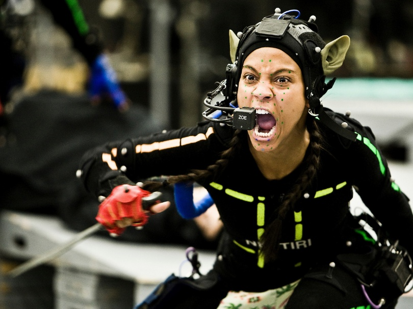
<figcaption>
Gambar 2.1
Teknologi <em>Performance Capture</em> pada Produksi Film
Avatar
</figcaption>
</figure>

(Sumber: beforesandafters.com, 2022)

Terdapat dua infrastruktur utama dalam pelacakan gerak: Inertial
Tracking (berbasis giroskop/akselerometer seperti Rokoko) dan Optical
Tracking (berbasis pantulan inframerah seperti OptiTrack). Berdasarkan
analisis komparatif, sistem inersial rentan terhadap pergeseran posisi
absolut (drift) dan tidak dapat digunakan untuk melacak benda
mati/properti fisik \[13\]. Oleh karena itu, Optical Tracking
(OptiTrack) menjadi standar industri yang lebih superior karena mampu
mendeteksi marker reflektif dengan presisi sub-milimeter, memberikan
data posisi absolut 6-DoF (Degrees of Freedom) secara konstan dengan
latensi sangat rendah. Hal ini menjadikannya pondasi mutlak untuk
menyinkronkan kamera virtual dan pedang fisik di ruang digital \[12\].

### Integrasi Data melalui Plugin Motive for Blender

Perangkat lunak Motive bertindak sebagai server utama yang memproses
tangkapan inframerah dari kamera fisik menjadi kalkulasi matriks rotasi
dan lokasi. Data pelacakan *Rigid Body* (kamera/properti) maupun
*Skeleton* (tulang aktor) ini kemudian disiarkan melalui jaringan lokal
menggunakan protokol UDP/NatNet. Kehadiran OptiTrack Blender Plugin
(Gambar 2.2) memfasilitasi injeksi aliran data tersebut secara real-time
ke dalam Blender, memungkinkan simulasi tanpa perlu berpindah ke *game
engine* pihak ketiga.

<figure>
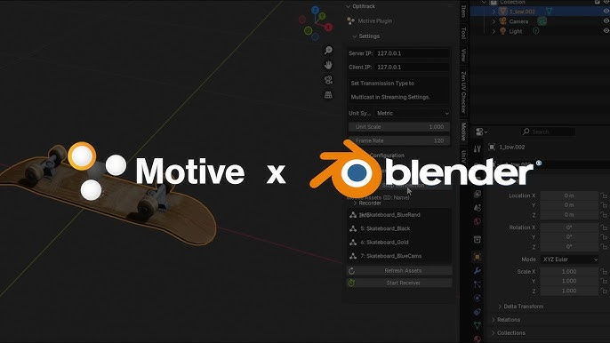
<figcaption>
Gambar 2.2
OptiTrack Blender Plugin for Motive
</figcaption>
</figure>

(Sumber: OptiTrack, 2026)

### *Motion Retargeting* pada Blender

Aliran data gerak (Skeleton) dari OptiTrack umumnya memiliki struktur
hierarki penamaan tulang (bone hierarchy) yang berbeda dengan rig model
3D target (seperti kerangka standar Mixamo). Oleh karena itu, diperlukan
proses Motion Retargeting, yaitu rekayasa animasi untuk memetakan
(mapping) data rotasi dari kerangka sumber (source skeleton) menuju
kerangka target (target rig). Di Blender, hal ini diselesaikan dengan
mengalkulasi orientasi sumbu lokal dan memasang sistem pembatas tulang
(Bone Constraints) agar karakter *stylized* dapat merespons pergerakan
aktor secara seketika maupun secara *offline* melalui integrasi data
FBX/BVH \[14\].

### *Non-Photorealistic Rendering* (NPR) dan Gaya *Painterly*

*Non-Photorealistic Rendering* (NPR) merupakan kategori dalam metodologi
komputasi grafika yang bertujuan menghasilkan estetika visual di luar
simulasi fotorealisme konvensional. Gaya *painterly* berupaya
menciptakan geometri yang mempertahankan keluwesan coretan kuas
(*brushstroke*), sehingga objek 3D dapat mengekspresikan karakter
organik layaknya ilustrasi 2D (Gambar 2.3) \[1\], \[2\], \[18\].

<figure>
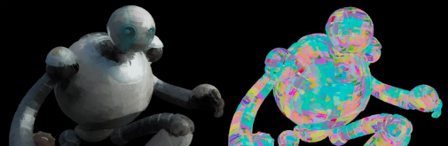
<figcaption>
Gambar 2.3
Representasi Visual 3D Bergaya <em>Painterly</em>
</figcaption>
</figure>

(Sumber: Verlander *et al.*, 2025)

Dalam pendekatan animasi modern, lingkungan diperlakukan sebagai
karakter tersendiri yang hidup dan berinteraksi secara visual \[8\].
Untuk mencapai tingkat kepadatan yang tinggi tanpa menguras sumber daya
komputasi, teknik penggandaan geometri (*instancing*) digunakan secara
masif \[2\]. Penanganan transparansi tumpang tindih pada dedaunan
(*foliage*) sering kali membutuhkan kalkulasi khusus, yang di industri
besar diatasi menggunakan format data berlapis seperti *Crypto-Deep*
melalui proses *compositing* \[7\].

### Manajemen Memori dan *Material Instancing*

Permasalahan *memory bloat* terjadi ketika ratusan variasi objek
menggunakan *slot* material yang berbeda-beda secara independen.
*Material Instancing* adalah konsep efisiensi komputasi di mana hanya
terdapat satu material induk (*Master Node*). Instruksi variasi warna
atau distorsi disuntikkan secara dinamis melalui data atribut pada
tingkat objek (*Object Custom Properties*). Pendekatan ini secara
drastis menekan beban alokasi memori (*VRAM* maupun *RAM*) saat memuat
*scene* *Virtual Cinematography* berskala besar.

### Arsitektur Node EEVEE Next dan Otomatisasi Python (bpy)

Blender menyediakan antarmuka pemrograman aplikasi (API) berbasis Python
(bpy) yang memungkinkan ekstensibilitas fungsi secara menyeluruh (Gambar
2.4). Skrip Python dapat mengakses data fundamental seperti geometri
*mesh*, sistem antarmuka, hingga arsitektur simpul (*node tree*) \[11\].

<figure>
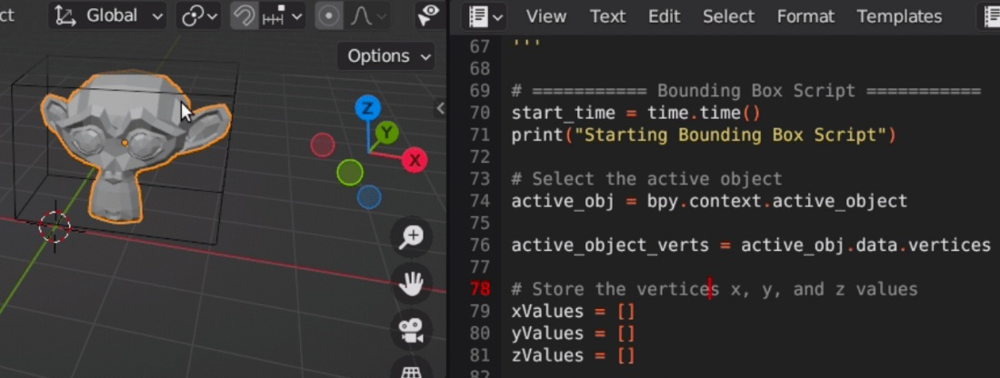
<figcaption>
Gambar 2.4
Antarmuka Scripting API Python pada Blender
</figcaption>
</figure>

(Sumber: Shah, 2024)

EEVEE Next, sebagai arsitektur *render engine* hibrida terbaru Blender,
menangani komputasi material berbasis *Shader Nodes*. Melalui manipulasi
API Python, logika material yang rumit dapat dienkapsulasi menjadi
antarmuka (*Add-on*) yang sederhana, mengubah proses eksperimen
komputasi geometri menjadi *toolset* produksi yang ramah pengguna
\[11\].

### *Multimedia Development Life Cycle* (MDLC)

Metode pengembangan yang digunakan dalam penelitian ini adalah
*Multimedia Development Life Cycle* (MDLC) yang diusulkan oleh Luther
(1994) \[19\]. MDLC merupakan kerangka kerja terstruktur yang dirancang
khusus untuk pengembangan proyek multimedia, menjadikannya sangat sesuai
untuk merancang Authoring Tool grafis. Implementasi metode ini
dilaksanakan melalui enam fase sistematis yang saling berkesinambungan.
Tahap pertama adalah *Concept* (Konsep), di mana penulis merumuskan
spesifikasi fungsional perangkat *Add-on* Python beserta parameter
pengujian untuk kebutuhan previzualisasi. Selanjutnya pada tahap
*Design* (Perancangan), dilakukan pemetaan arsitektur jaringan
Client/Server NatNet serta perancangan logika flowchart pemrograman
Python untuk sistem Material Instancing, yang mencakup tiga Master Node
utama (Opaque, Foliage, dan Emissive).

Memasuki tahap *Material Collecting* (Pengumpulan Materi), penulis
menghimpun berbagai aset pendukung esensial, seperti model 3D organik
(stylized assets), data motion capture dari Motive, hingga perumusan
algoritma noise prosedural. Seluruh materi tersebut kemudian diproses
pada tahap *Assembly* (Pembuatan) melalui integrasi sistem berbasis
pemrograman Python (bpy). Pada fase ini, seluruh fungsionalitas logika
dienkapsulasi ke dalam wujud antarmuka *Add-on*, bersamaan dengan
penyusunan script untuk kebutuhan *Retargeting*. Setelah proses
perakitan selesai, sistem dievaluasi pada tahap *Testing* (Pengujian)
secara komprehensif, yang berfokus pada analisis reduksi memory bloat,
optimalisasi posisi marker OptiTrack pada properti fisik (pedang), serta
evaluasi kestabilan sistem melalui rendering demonstrasi adegan
berdurasi 1 menit. Terakhir, pada tahap *Distribution* (Distribusi),
rancangan skrip yang telah divalidasi dikemas menjadi berkas plugin
berekstensi (.zip) yang utuh dan siap dipublikasikan ke dalam platform
seperti Superhive.

> .

## PENELITIAN TERKAIT

Penelitian ini dibangun berdasarkan evaluasi kritis terhadap berbagai
studi sebelumnya yang berfokus pada optimasi grafika 3D dan
Pre-Visualization.

Penelitian pertama oleh Oktavian (2025) berhasil mengimplementasikan
simulasi tata kamera real-time \[10\]. Meskipun mampu mengintegrasikan
motion capture, penggunaan mesin render eksternal ini menciptakan
*pipeline friction* karena terputusnya ekosistem antara tahapan
modifikasi aset 3D dan previzualisasi \[10\]. Di samping itu, literatur
teknis dari produksi animasi kelas atas \[7\] membuktikan bahwa
penanganan lingkungan padat bergaya lukisan sering kali mengandalkan
metode pasca-produksi (compositing Crypto-Deep) yang sangat berat
(Gambar 2.5) dan sama sekali tidak aplikatif untuk peninjauan
*real-time* di layar kerja (viewport).

<figure>
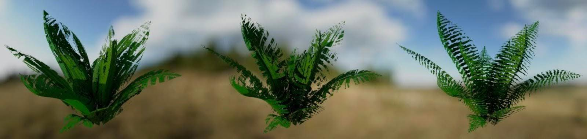
<figcaption>
Gambar 2.5
Penanganan Transparansi Kompleks dengan Data
Crypto-Deep
</figcaption>
</figure>

(Sumber: Verlander *et al.*, 2025)

Pendekatan tekstur generatif oleh Lee dan Hou (2025) melalui Generative
Tonal Art Maps berbasis web (p5.js) membuktikan bahwa pola coretan kuas
dapat digenerasi secara eksternal \[20\]. Namun, generasi tekstur
eksternal ini membatasi kontrol langsung seniman terhadap respons cahaya
3D (Gambar 2.6).

<figure>
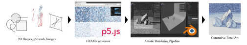
<figcaption>
Gambar 2.6
<em>Stylization workflow</em> dengan p5.js
</figcaption>
</figure>

(Sumber: Lee dan Hou, 2025)

Menyikapi celah tersebut, integrasi perangkat keras OptiTrack, seperti
yang dibahas oleh Jenna Ng (2012) \[9\] dan divalidasi keandalannya
secara komparatif oleh Santos et al. (2021) \[13\], menjadi krusial
untuk melacak entitas fisik secara akurat tanpa drift. Berdasarkan
tinjauan tersebut, kebaruan (novelty) penelitian ini adalah penyusunan
Reusable NPR Shader Pipeline melalui Add-on Python di Blender untuk
mengatasi memory bloat secara *native*, sekaligus menyimulasikan sistem
Virtual Cinematography dan properti Optical Tracking di dalam ekosistem
tunggal. Posisi penelitian ini dirangkum pada Tabel 2.1.

| **Fokus Penelitian** | **Penulis / Sumber** | **Kekurangan / Celah Penelitian (Research Gap)** | **Solusi yang Diusulkan Penelitian Ini** |
|:--:|:--:|:--:|:--:|
| Simulasi Kamera Real-Time | A. R. Oktavian (2025) \[10\] | Terputusnya alur kerja antara pemodelan 3D dan mesin *render*. | Menyatukan pemodelan aset dan simulasi Virtual Cinematography dalam ekosistem tunggal Blender. |
| Integrasi Seni 2D di Ruang 3D (*Doodle*) | M. Losure (2025) \[18\] | Bergantung pada *compositing* pasca-produksi yang sangat berat dan memakan memori besar. | Menciptakan Master Node berbasis matematika vektor yang dieksekusi secara instan di *Viewport.* |
| Generative Tonal Art | Y.-C. Lee & J.-H. Hou (2025) \[20\] | Pola coretan kuas digenerasi pada ekosistem terpisah (berbasis web/p5.js). | Mengenkapsulasi parameter tekstur prosedural langsung ke dalam UI Blender. |
| Pengukuran Latency Motion Capture | G. Santos et al. (2021) \[13\] | Fokus riset masih terbatas pada komparasi sensor optical vs inertial tanpa luaran rekayasa perangkat lunak 3D lanjutan. | Memanfaatkan keunggulan Optical Tracking untuk mengintegrasikan kamera dan properti fisik (pedang) secara langsung ke Blender. |
| *Scripting* Algoritma Geometri 3D | M. D. Shah (2024) \[11\] | Studi kasus masih terbatas pada pembuatan geometri dasar (seperti *Bounding Box*). | Mengembangkan *scripting* untuk merekayasa arsitektur material (*Material Instancing*). |

Tabel 2.1 Matriks
Tinjauan Penelitian Terkait

\
DESAIN SISTEM
=============

Pada bab ini akan diuraikan secara komprehensif mengenai perencanaan
teknis, landasan arsitektural, serta metodologi penyelesaian masalah
yang ditawarkan sebelum sistem benar-benar diimplementasikan ke dalam
tahap produksi. Penjabaran dalam bab ini bertindak sebagai cetak biru
(blueprint) penelitian, yang mencakup deskripsi rancangan solusi,
topologi arsitektur sistem, analisis spesifikasi kebutuhan perangkat
keras maupun perangkat lunak, hingga kerangka kerja metodologi
pengembangan. Seluruh tahapan perancangan ini akan dipandu secara
sistematis menggunakan pendekatan *Multimedia Development Life Cycle*
(MDLC) guna memastikan sistem yang dibangun terstruktur, terukur, dan
tepat sasaran.

## DESKRIPSI SOLUSI

Solusi rekayasa yang diusulkan dalam penelitian ini dibangun di atas dua
pilar utama yang saling terintegrasi di dalam satu ekosistem Blender.
Pilar pertama berfokus pada penyelesaian masalah inefisiensi memori
(memory bloat) yang kerap membebani komputasi grafis pada scene berskala
besar. Solusi ini diwujudkan melalui pengembangan perangkat tambahan
(Add-on) kustom "Shader Automation Pipeline" yang dikendalikan
menggunakan antarmuka pemrograman aplikasi (API) Python (bpy). Add-on
ini dirancang untuk membangkitkan dan mengalokasikan parameter material
secara prosedural, mereplikasi efisiensi arsitektur *Material
Instancing* guna menghindari duplikasi simpul material (node tree) yang
menguras kapasitas VRAM pada mesin perender.

Pilar kedua menitikberatkan pada implementasi alur kerja *Virtual
Cinematography* dan *Pre-Visualization* interaktif melalui integrasi
infrastruktur pelacakan optik OptiTrack Motive. Pada pilar ini, aliran
data *Rigid Body* ditransmisikan secara mendekati waktu nyata (near
real-time) dengan latensi sangat rendah menggunakan protokol jaringan
UDP/NatNet. Data koordinat absolut (6-DoF) tersebut disiarkan dan
disuntikkan secara langsung untuk mengendalikan transformasi objek
kamera (Virtual Camera) dan properti 3D fisik (seperti replika pedang)
di dalam layar pengawasan (viewport). Sementara itu, pergerakan
biomekanik aktor (Skeleton) akan diproses dan dipetakan ulang
(retargeting) secara dinamis ke dalam kerangka (rig) karakter 3D.

Sebagai fondasi kelayakan teknis dan untuk meminimalisir risiko
kegagalan sistem pada tahap pengembangan lanjutan, beberapa tahapan
eksperimen awal (preliminary research) telah berhasil dilaksanakan dan
divalidasi. Pembuktian purwarupa tersebut meliputi:

### Tranmisi Data *Skeleton*

<figure>
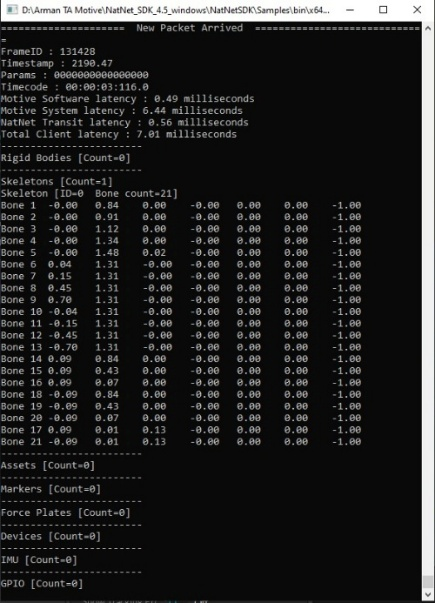
<figcaption>
Gambar 3.1
Transmisi Data <em>Skeleton</em> secara
<em>Real-Time</em>
</figcaption>
</figure>

Keberhasilan transmisi data kerangka tulang (Skeleton) dari perangkat
lunak OptiTrack Motive ke ekosistem Blender secara waktu nyata
(real-time) pada Gambar 3.1.

### Skrip Kustom Untuk *Retargeting*

Keberhasilan pembuatan skrip Python kustom untuk pemetaan ulang
(retargeting) data kerangka (Skeleton) secara waktu nyata (Gambar 3.2).
Skrip ini dirancang untuk menyinkronkan data antar-kerangka dengan cara
mencocokkan konvensi penamaan tulang (bone naming convention).

<figure>
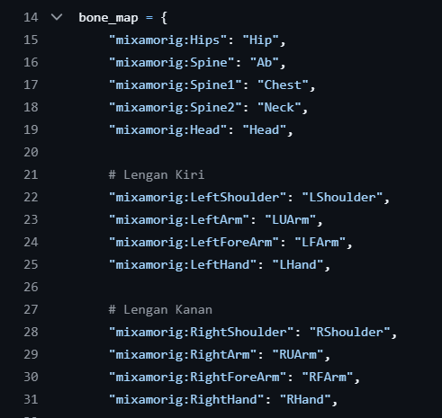
<figcaption>
Gambar 3.2
Snippet kode <em>bone naming convention</em>
</figcaption>
</figure>

Melalui pemberian Bone Constraint secara terprogram menggunakan Python,
rotasi tulang dari OptiTrack Motive dapat ditranslasikan secara langsung
dan akurat ke hierarki tulang karakter target (misalnya standar rig
Mixamo).

### Transmisi Data *Rigid Body*

<figure>
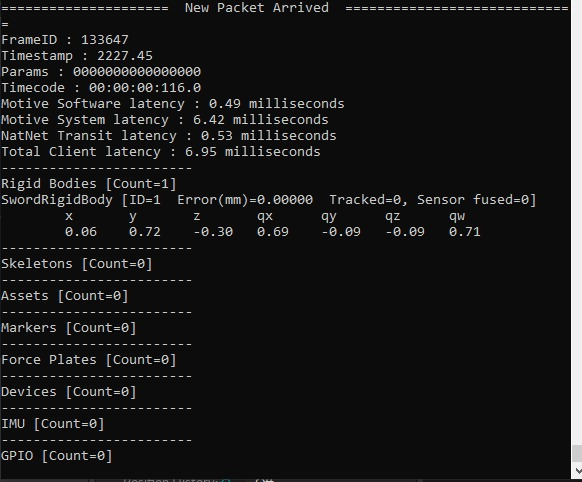
<figcaption>
Gambar 3.3
Transmisi Data <em>Rigid Body</em> secara
<em>Real-Time</em>
</figcaption>
</figure>

Keberhasilan transmisi pelacakan benda kaku (Rigid Body) untuk
mengendalikan objek 3D di Blender (Gambar 3.3).

### Modifikasi OptiTrack Blender Plugin

Modifikasi kode sumber (source code) dilakukan pada ekstensi OptiTrack
Blender Plugin, secara spesifik pada modul app_handlers.py yang bertugas
sebagai listener paket data UDP. Secara bawaan (default), sistem
menerapkan logika kondisional yang secara ketat membatasi penempelan
data Rigid Body hanya pada entitas berbasis MESH. Modifikasi dilakukan
dengan memperlebar parameter penyeleksian (array tipe objek) agar sistem
mampu merespons dan melacak entitas CAMERA dan EMPTY (Gambar 3.4).
Modifikasi arsitektur modul ini memungkinkan kamera virtual dan properti
fisik dikendalikan secara langsung. Modifikasi ini juga telah disetujui
secara resmi oleh pengembang OptiTrack melalui Pull Request GitHub
(bukti terlampir pada Lampiran 1).

<figure>
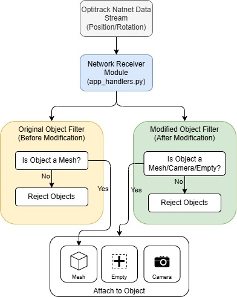
<figcaption>
Gambar 3.4
Optitrack <em>Plugin Modification</em> (Object Filter
Logic)
</figcaption>
</figure>

### Purwarupa Add-on Material Instancing NPR di Blender 

Keberhasilan pembuatan purwarupa fungsional Add-on Material Instancing
NPR (Gambar 3.5). Secara logika kode, skrip Python ini memanfaatkan
struktur bpy.types.PropertyGroup untuk mendaftarkan parameter variabel
secara spesifik ke dalam metadata masing-masing objek (Object Custom
Properties). Hal ini memungkinan untuk perubahan *value* pada
masing-masing *object* yang berbeda tanpa mengubah value *object*
lainnya, membuat memori hanya menyimpan satu material untuk banyak
*object.*

<figure>
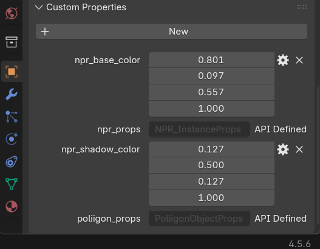
<figcaption>
Gambar 3.5
kontrol parameter shader di <em>object custom
properties</em>
</figcaption>
</figure>

Variabel independen tersebut kemudian dihubungkan ke dalam susunan
Master Material menggunakan simpul ShaderNodeAttribute pada EEVEE Next
(Gambar 3.6).

<figure>
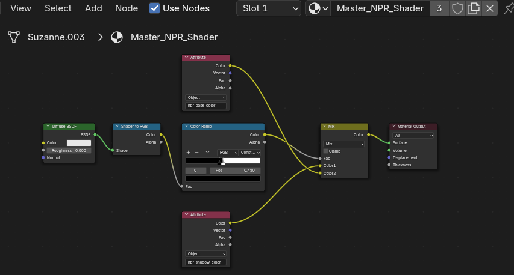
<figcaption>
Gambar 3.6
Shader node dengan komponen <em>attributes</em> untuk kontrol
parameter
</figcaption>
</figure>

Mekanisme ini memungkinkan modifikasi parameter visual secara individual
dan dinamis pada layar pengawasan (viewport) tanpa perlu menduplikasi
slot material ke dalam memori (Gambar 3.7).

<figure>
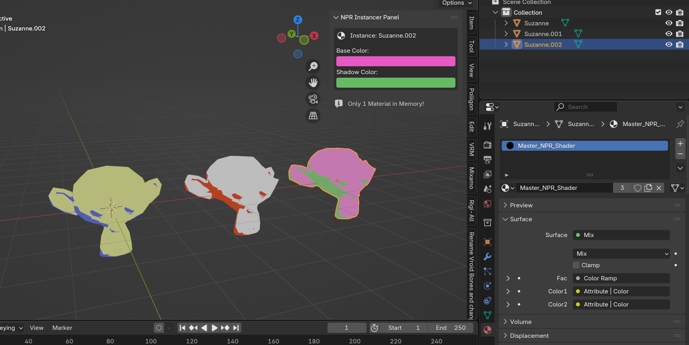
<figcaption>
Gambar 3.7
Uji Coba Purwarupa <em>Add-on Material Instancing</em> pada Layar
<em>Viewport</em>
</figcaption>
</figure>

Melalui pembuktian purwarupa awal tersebut, sistem ini dipastikan layak
untuk dikembangkan lebih lanjut menjadi alur kerja produksi animasi dan
virtual sinematografi yang utuh.

## ARSITEKTUR SISTEM

Secara garis besar, arsitektur penyelesaian masalah pada penelitian ini
mengintegrasikan infrastruktur perangkat keras pelacakan optik (Optical
Tracking) dengan ekosistem perangkat lunak 3D untuk kebutuhan Virtual
Sinematografi. Gambaran arsitektur umum dari sistem ini divisualisasikan
pada Gambar 3.8 berikut:

<figure>
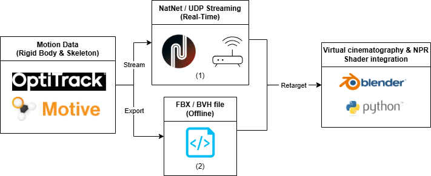
<figcaption>
Gambar 3.8
Arsitektur Integrasi Sistem Virtual cinematography dan NPR
Shader
</figcaption>
</figure>

Berdasarkan Gambar 3.8, Sistem beroperasi melalui pendekatan hibrida
yang menghubungkan dua lingkungan utama. Lingkungan pertama berfokus
pada akuisisi data pelacakan gerak (Rigid Body dan Skeleton) menggunakan
sistem OptiTrack dan perangkat lunak Motive. Transmisi data dari Motive
menuju ekosistem penerima di Blender dilakukan melalui dua jalur
integrasi: (1) siaran jaringan lokal secara waktu nyata (real-time
streaming) menggunakan protokol UDP/NatNet untuk mengendalikan kamera
virtual dan properti (pedang), serta (2) integrasi luring (offline
integration) melalui ekspor berkas FBX/BVH untuk pemetaan ulang
(retargeting) pergerakan kerangka karakter (Skeleton).

Di dalam Blender, seluruh data gerak tersebut diaplikasikan pada aset
karakter dan lingkungan 3D bergaya stylized. Untuk memastikan simulasi
sinematografi dan previzualisasi ini terbebas dari masalah pemborosan
memori (memory bloat) dan berjalan pada laju bingkai (FPS) yang stabil,
efisiensi rendering disempurnakan melalui eksekusi Add-on "Shader
Automation Pipeline" yang mengotomatisasi arsitektur Material
Instancing.

Secara spesifik, kontribusi rekayasa perangkat lunak yang dilakukan oleh
penulis dalam arsitektur sistem ini berfokus pada dua lapisan (layer)
utama:

1.  Layer *Middleware* (Integrasi Data): Penulis merekayasa modul skrip
    penerima (handler) pada sisi klien Blender agar mampu
    mendepaketisasi dan menerjemahkan data absolut 6-DoF dari jaringan
    NatNet langsung ke entitas non-geometri (Camera dan Empty), yang
    sebelumnya tidak didukung oleh sistem bawaan.

2.  Layer Presentasi (Visual & Rendering): Penulis membangun arsitektur
    otomasi menggunakan API Python (bpy) pada mesin perender EEVEE Next
    untuk membangkitkan susunan simpul (node tree) secara prosedural.
    Layer ini bertugas mengalokasikan parameter properti objek tanpa
    melakukan duplikasi material di memori (Material Instancing).

## ANALISIS KEBUTUHAN SISTEM

Keberhasilan perancangan, implementasi, dan pengujian keandalan sistem
pada penelitian ini sangat bergantung pada kesesuaian spesifikasi
perangkat yang dilibatkan. Mengingat arsitektur sistem ini menuntut
komputasi tingkat tinggi yang mengintegrasikan mesin perender grafis
(EEVEE Next) dan pemrosesan aliran data pelacakan jaringan (NatNet)
secara mendekati waktu nyata (near real-time), maka pemilihan perangkat
harus dievaluasi secara presisi guna menghindari hambatan kinerja
(bottleneck) pada infrastruktur. Oleh karena itu, analisis kebutuhan
sistem dalam bab ini diklasifikasikan secara spesifik menjadi dua pilar
utama, yakni kebutuhan perangkat keras (hardware) sebagai fondasi
komputasi fisik, dan kebutuhan perangkat lunak (software) sebagai
ekosistem operasional pengembangan rekayasa.

### Kebutuhan Perangkat Keras (*Hardware*)

Perangkat keras yang digunakan harus memiliki kapabilitas pemrosesan
grafis yang memadai untuk menjalankan mesin perender EEVEE Next dan
menangkap lalu lintas data pelacakan (*tracking*) dari jaringan lokal
(NatNet). Spesifikasi perangkat keras yang digunakan merujuk pada
fasilitas Lab *Motion Capture* Politeknik Elektronika Negeri Surabaya,
dengan rincian pada Tabel 3.1 berikut:

| **Komponen** | **Spesifikasi & Fungsi** |
|:--:|:--:|
| Unit Pemrosesan Pusat (CPU) | Prosesor Intel Core i9-9980XE untuk memproses kalkulasi skrip Python dan eksekusi laju bingkai animasi. |
| Unit Pemrosesan Grafis (GPU) | Kartu grafis terdedikasi NVIDIA Quadro P6000 dengan kapasitas 24 GB GDDR5X VRAM untuk mendukung komputasi *Ray Tracing* pada EEVEE Next. |
| Memori (RAM) | Kapasitas 130 GB guna menangani komputasi aset 3D yang padat serta sistem operasi *multitasking*. |
| Perangkat Pelacakan Fisik | Infrastruktur sistem kamera OptiTrack yang dikonfigurasi untuk mentransmisikan data *Rigid Body* secara presisi. |

Tabel 3.1 Spesifikasi
Kebutuhan Perangkat Keras

### Kebutuhan Perangkat Lunak (*Software*)

Perangkat lunak (software) yang digunakan dalam penelitian ini memegang
peranan krusial sebagai ekosistem pengembangan utama (authoring tool)
yang mewadahi seluruh siklus rekayasa sistem. Ekosistem ini tidak hanya
bertindak sebagai kanvas untuk simulasi 3D, tetapi juga menyediakan
antarmuka pemrograman aplikasi (API) untuk penulisan kode sumber (skrip
Python), perancangan antarmuka pengguna (UI) kustom pada *Add-on*, serta
lingkungan komputasi untuk pengujian logika material prosedural secara
real-time. Di samping itu, perangkat lunak pendukung di sisi pelacakan
gerak juga diperlukan untuk mengakuisisi, mendepaketisasi, dan
menyiarkan aliran data optik melalui protokol jaringan lokal. Oleh
karena itu, pemilihan spesifikasi perangkat lunak ini didasarkan pada
tingkat kompatibilitas integrasi antar-sistem, stabilitas mesin perender
EEVEE, serta fleksibilitasnya dalam menangani lingkungan sinematografi
virtual. Secara komprehensif, rincian spesifikasi dan fungsi dari
masing-masing perangkat lunak yang dilibatkan dalam pengembangan sistem
ini dijabarkan pada Tabel 3.2 berikut:

| **Komponen** | **Spesifikasi & Fungsi** |
|:--:|:--:|
| Perangkat Lunak Utama | (Versi 4.2 atau terbaru) yang digunakan sebagai Authoring Tool pemodelan 3D, pemrograman antarmuka UI Add-on, dan simulasi previzualisasi EEVEE Next. |
| Bahasa Pemrograman | Python (Versi 3.x) sebagai fondasi dari pustaka API bpy di Blender untuk mengotomatisasi generasi *node* dan rekayasa *Custom Properties*. |
| Perangkat Lunak Pelacakan | OptiTrack Motive 2.1.1 yang berfungsi sebagai server jaringan (NatNet) untuk menyiarkan data pergerakan tulang dan *Rigid Body* secara *real-time*. |
| Ekstensi Integrasi Jaringan | OptiTrack Blender Plugin v1.1.1 yang bertugas sebagai klien untuk menerima aliran data UDP secara langsung ke dalam kerangka parameter animasi Blender. |

Tabel 3.2 Spesifikasi
Kebutuhan Perangkat Lunak

## PERANCANGAN SISTEM

Penelitian ini menggunakan kerangka kerja Multimedia Development Life
Cycle (MDLC) yang terdiri dari 6 tahapan secara rinci. Alur tahapan
metodologi penelitian ini divisualisasikan pada Gambar 3.9 berikut:

<figure>
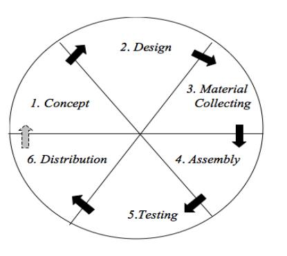
<figcaption>
Gambar 3.9
Alur Metodologi Penelitian MDLC
</figcaption>
</figure>

(Sumber: Aryani *et al.*, 2024)

Berdasarkan Gambar 3.9, tahapan dimulai dari pendefinisian konsep
fungsionalitas sistem, dilanjutkan dengan perancangan arsitektur
antarmuka dan logika pemrograman. Setelah rancangan disetujui, tahap
pengumpulan materi dilakukan untuk menyiapkan aset 3D dan data pelacakan
(*tracking*) agar tahap selanjutnya dapat dilanjutkan, pengumpulan
materi dengan memperhatikan lisensi agar tidak terjadi masalah
dikemudian hari. Selanjutnya, proses perakitan kode dieksekusi pada
tahap pembuatan, yang kemudian divalidasi kinerjanya melalui tahap
pengujian simulasi previzualisasi. Tahap akhir adalah distribusi, di
mana perangkat lunak dikemas untuk siap digunakan dan di distribusikan
ke platform komunitas Blender. Berikut adalah jabaran mendetail dari
masing-masing tahapan pengembangan:

### Tahap Konsep (*Concept*)

Tahap Konsep (Concept) merupakan fase fundamental di mana penulis
mengidentifikasi permasalahan krusial pada alur kerja produksi animasi
konvensional dan merumuskan spesifikasi fungsional dari solusi yang
ditawarkan. Tujuan utama dari pengembangan sistem ini berpusat pada dua
inisiatif inovasi rekayasa. Inisiatif pertama adalah perancangan
perangkat rekayasa tambahan (authoring tool) berbasis antarmuka
pemrograman aplikasi (API) Python yang ditujukan untuk mengotomatisasi
alokasi memori secara efisien di dalam Blender, sehingga batasan
komputasi memori (memory bloat) pada scene yang padat dapat diselesaikan
secara definitif. Inisiatif kedua berfokus pada perumusan konsep
*Virtual Cinematography*, yaitu dengan mengintegrasikan sistem pelacakan
optik presisi tinggi (OptiTrack Motive) ke dalam ekosistem perenderan
EEVEE Next. Integrasi ini dikonsepkan untuk memungkinkan sutradara atau
*Technical Artist* melakukan simulasi tata kamera dan memanipulasi
interaksi properti fisik di tahapan previzualisasi (pre-visualization)
secara interaktif, tanpa perlu mengekspor data secara terpisah ke
perangkat lunak pihak ketiga (game engine).

### Tahap Perancangan (*Design*)

Setelah rumusan spesifikasi fungsional disepakati, tahap selanjutnya
adalah Tahap Perancangan (Design), yang berfungsi sebagai pemetaan cetak
biru (blueprint) teknis secara menyeluruh sebelum fase penulisan kode
(coding) dan perakitan sistem benar-benar dieksekusi. Fase ini sangat
esensial untuk mencegah terjadinya penumpukan logika kode yang tidak
terstruktur (technical debt) agar saat pembuatan kode keterbacaan kode
bisa terstruktur dan baik serta memastikan seluruh modul integrasi dapat
beroperasi secara sinkron. Dalam penelitian ini, perancangan sistem
diklasifikasikan secara spesifik ke dalam dua pilar arsitektur utama.
Pilar pertama adalah perancangan arsitektur jaringan komunikasi data
yang bertugas memfasilitasi transmisi pelacakan gerak fisik ke dalam
ruang digital. Sementara pilar kedua adalah perancangan arsitektur
perangkat lunak (software architecture) berbasis *flowchart* logika
prosedural, yang akan mendasari mekanisme eksekusi *Add-on* dalam
mengendalikan parameter ekosistem Non-Photorealistic Rendering (NPR) di
ruang kerja Blender.

#### Arsitektur Jaringan (NatNet Streaming)

Sistem membutuhkan aliran data dengan latensi sangat rendah. Komunikasi
data antara sistem OptiTrack dan Blender dirancang menggunakan protokol
jaringan *client/server* NatNet. Protokol ini memanfaatkan *User
Datagram Protocol* (UDP) dengan komunikasi *Multicast* untuk
mengintegrasikan dan menyiarkan data *Rigid Body* dan *Skeleton* secara
*real-time*.

<figure>
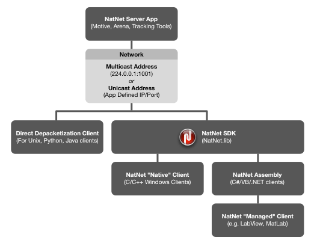
<figcaption>
Gambar
3.10 Arsitektur Jaringan Client/Server NatNet Streaming
</figcaption>
</figure>

(Sumber: OptiTrack, 2026)

Berdasarkan arsitektur tersebut, perangkat lunak Motive bertindak
sebagai *NatNet Server App* yang memancarkan data pelacakan (Gambar
3.10). Sementara itu, ekosistem Blender akan menerima aliran data
tersebut melalui *plugin* klien yang dibangun di atas fondasi *NatNet
SDK* atau *Direct Depacketization Client* (berbasis Python). Pendekatan
ini memastikan data rotasi (*quaternion* maupun *Euler*) dan translasi
dapat diaplikasikan langsung pada objek 3D di dalam Blender.

#### **Arsitektur Logika Prosedural API Python** 

Merancang algoritma skrip Python. Logika didesain menggunakan
percabangan kondisi: jika Master Material belum ada, sistem menggunakan
perintah nodes.new() untuk membangkitkan susunan simpul EEVEE Next. Jika
sudah ada, sistem menggunakan perintah materials.append() untuk
menggunakan ulang material tersebut, menghindari duplikasi (Gambar
3.11).

<figure>
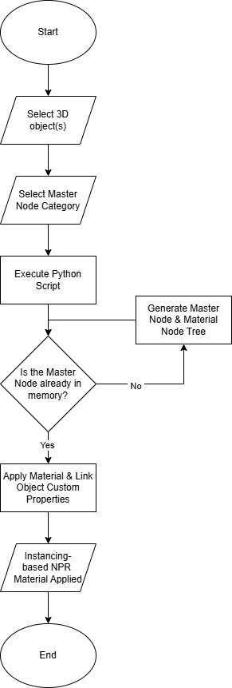
<figcaption>
Gambar
3.11 Flowchart Desain Sistem Eksekusi Add-on Shader
Automation
</figcaption>
</figure>

#### Arsitektur Logika Material (*Node Tree Blueprints*) 

Merancang bangun topologi simpul (node tree) NPR di mesin perender EEVEE
Next yang dioptimalkan untuk kinerja real-time tanpa mengorbankan
estetika painterly. Arsitektur ini dibagi menjadi tiga pilar material
dasar yang bersifat prosedural:

1.  *Opaque Base*: Material padat dirancang menggunakan pendekatan
    manipulasi vektor matematika untuk mensimulasikan lighting
    non-fotorealistik. Dengan mengkombinasikan *Noise Texture* sebagai
    masking dinamis, sistem menghasilkan efek color banding (gradasi
    warna tegas) dan *edge distortion* yang memberikan tekstur "kuas"
    pada objek padat, sehingga meminimalisir tampilan plastik yang
    sering terjadi pada perenderan 3D standar.

2.  *Foliage Base*: Material vegetasi dirancang dengan parameter Alpha
    Cutout yang presisi untuk menghilangkan geometri kosong pada mesh
    yang kompleks. Selain itu, enkapsulasi matematika vektor digunakan
    untuk mensimulasikan pencahayaan tembus pandang (fictional
    subsurface scattering). Hal ini memungkinkan daun atau vegetasi
    merespons cahaya matahari secara organik, memberikan kedalaman
    visual yang realistis namun tetap dalam gaya stylized.

3.  *Emissive Base*: Material Material sumber cahaya dikonfigurasi agar
    berinteraksi secara reaktif terhadap Bloom di Viewport Compositor.
    Sistem ini menyertakan kontrol intensitas pendaran (glow) yang dapat
    diatur secara dinamis, serta penambahan tekstur berbutir (procedural
    grain) yang dihasilkan oleh algoritma *noise*, memberikan
    karakteristik visual yang hidup dan konsisten dengan estetika
    painterly secara keseluruhan.

### Tahap Pengumpulan Materi (*Material Collecting*)

Tahap ini tidak sekadar mengumpulkan aset, melainkan melakukan validasi
dan persiapan data empiris yang krusial untuk menjamin stabilitas
*real-time rendering* dan akurasi pelacakan. Fase ini meliputi:

1.  Aset 3D Lingkungan dan Karakter: Mengumpulkan dan mempersiapkan aset
    3D mentah (raw mesh) berupa karakter humanoid, properti senjata, dan
    lingkungan yang belum memiliki material. Memastikan topologi mesh
    dalam kondisi optimal untuk *real-time rendering*.

2.  Data Pelacakan Gerak: Mengakuisisi data koordinat pelacakan *Rigid
    Body* dan *Skeleton* secara langsung di studio lab menggunakan
    *suit* dan marker reflektif. Properti fisik (pedang replika) juga
    dipasangi marker optik khusus untuk mengumpulkan data interaksi
    spasial yang presisi, yang kemudian akan menjadi data input untuk
    simulasi interaksi di ruang 3D.

3.  Modul Perangkat Lunak Inti: Mengumpulkan dan mengonfigurasi pustaka
    (library) OptiTrack NatNet SDK dan ekstensi dasar OptiTrack Blender
    Plugin yang akan menjadi interface komunikasi jaringan, guna
    memastikan kompabilitas sebelum dilakukan tahapan rekayasa kode
    sumber (source code modification).

### Tahap Pembuatan (*Assembly*)

Tahap konstruksi dilakukan melalui penulisan kode terstruktur
(Procedural Technology Code) di ekosistem Blender, yang mengintegrasikan
seluruh logika sistem menjadi *Add-on* yang kohesif. Proses ini
mencakup:

1.  Modifikasi Sistem Penerima UDP (OptiTrack Plugin): Melakukan
    rekayasa kode pada skrip asli OptiTrack Blender Plugin. Modifikasi
    difokuskan pada pelebaran parameter penyeleksian (filtering logic)
    penerimaan data Rigid Body pada fungsi listener UDP. Dengan
    memodifikasi array tipe objek yang diizinkan, sistem kini tidak lagi
    membatasi penempelan data pada MESH saja, melainkan memperluas
    dukungan ke entitas CAMERA (sebagai kamera virtual) dan EMPTY
    (sebagai controller offset untuk properti fisik), yang sangat
    krusial dalam alur kerja *Virtual Cinematography*.

2.  Pembuatan Kelas Operator dan Properti *Add-on*: Menggunakan kelas
    bpy.types.Operator sebagai mesin eksekusi utama, serta
    bpy.types.PropertyGroup untuk melakukan enkapsulasi metadata
    variabel (seperti base color dan shadow intensity) secara spesifik
    ke dalam Object Custom Properties. Hal ini memungkinkan setiap objek
    menyimpan data parameter visualnya masing-masing tanpa harus membuat
    material node tree yang unik untuk setiap objek.

3.  Suntikan Attribute Node: Menulis algoritma skrip Python yang secara
    otomatis merangkai dan menyambungkan ShaderNodeAttribute pada Master
    Material. Teknologi ini memungkinkan material tunggal yang berada di
    memori untuk membaca nilai parameter yang berbeda-beda dari setiap
    objek 3D yang disentuhnya saat perenderan, sehingga secara efektif
    mereplikasi arsitektur *Material Instancing* yang sangat hemat
    memori.

### Tahap Pengujian (*Testing*)

<figure>
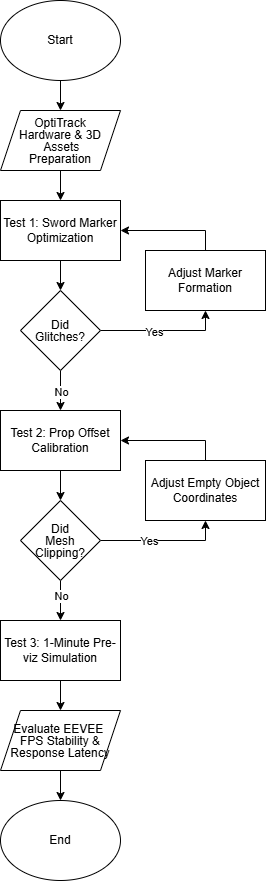
<figcaption>
Gambar
3.12 <em>Flowchart</em> Skenario Pengujian <em>Virtual
Cinematography</em>
</figcaption>
</figure>

Tahap pengujian merupakan evaluasi terhadap sistem rekayasa yang telah
dibangun. Pengujian difokuskan pada analisis pergerakan properti fisik
(Custom Props) dan simulasi adegan (Gambar 3.12), yang meliputi:

1.  Eksperimen Optimalisasi Marker: Menguji konfigurasi jumlah dan
    posisi penempatan marker reflektif pada pedang fisik. Analisis
    perbandingan (before-after) dilakukan untuk menemukan formasi marker
    yang meminimalisir anomali (glitch) saat properti digerakkan secara
    ekstrem.

2.  Kalibrasi Offset Properti: Menguji interaksi dua karakter yang
    memegang senjata. Evaluasi dilakukan untuk memperbaiki masalah
    persinggungan geometri (mesh clipping) antara proporsi pedang fisik
    dan pedang digital dengan menyematkan koordinat offset (X,Y,Z).

3.  Simulasi Pre-viz 1 Menit: Sistem akhir diuji dengan merekam
    demonstrasi adegan pertarungan karakter 3D berdurasi 1 menit.
    Pengujian ini mengevaluasi kelancaran manipulasi kamera virtual
    (guncangan dan rotasi keliling) serta kestabilan laju bingkai (FPS)
    pada EEVEE Next yang dikombinasikan dengan lingkungan NPR Instancer.

### Tahap Distribusi (*Distribution*)

Mengemas kode sumber *Add-on* Python dan standar operasional penempatan
marker ke dalam format yang siap dipublikasikan untuk komunitas pengguna
Blender maupun platform komersial seperti Superhive (Gambar 3.13).

<figure>
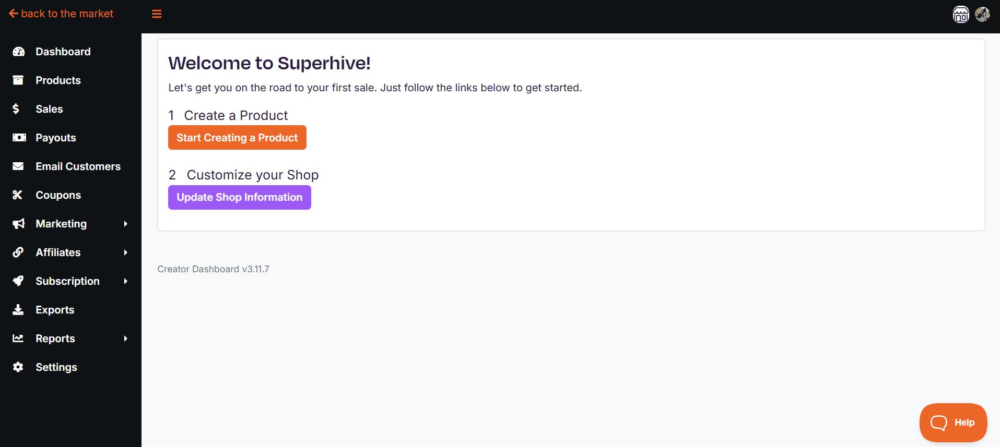
<figcaption>
Gambar
3.13 Dashboard kreator Superhive penulis yang sudah
terverifikasi
</figcaption>
</figure>

## JADWAL PENELITIAN

Tabel 3.3 berikut merangkum estimasi jadwal pengerjaan proyek akhir ini.
Alur pengerjaan dipetakan berdasarkan tahapan metode *Multimedia
Development Life Cycle* (MDLC), mulai dari perumusan konsep,
perancangan, pengumpulan aset, perakitan *Add-on*, pengujian komputasi,
hingga penulisan dan finalisasi laporan akhir. Rencana alokasi waktu
pengerjaan ini diproyeksikan berjalan selama 12 bulan.

<table style="width:87%;">
<caption>
Tabel 3.3
Jadwal Penelitian
</caption>
<colgroup>
<col style="width: 26%" />
<col style="width: 4%" />
<col style="width: 4%" />
<col style="width: 4%" />
<col style="width: 4%" />
<col style="width: 4%" />
<col style="width: 4%" />
<col style="width: 4%" />
<col style="width: 4%" />
<col style="width: 4%" />
<col style="width: 7%" />
<col style="width: 7%" />
<col style="width: 7%" />
</colgroup>
<thead>
<tr>
<th rowspan="2" style="text-align: center;">Tahapan</th>
<th colspan="12" style="text-align: center;">Waktu Pengerjaan
(Bulan)</th>
</tr>
<tr>
<th style="text-align: center;">1</th>
<th style="text-align: center;">2</th>
<th style="text-align: center;">3</th>
<th style="text-align: center;">4</th>
<th style="text-align: center;">5</th>
<th style="text-align: center;">6</th>
<th style="text-align: center;">7</th>
<th style="text-align: center;">8</th>
<th style="text-align: center;">9</th>
<th style="text-align: center;">10</th>
<th style="text-align: center;">11</th>
<th style="text-align: center;">12</th>
</tr>
</thead>
<tbody>
<tr>
<td style="text-align: center;">Concept</td>
<td> </td>
<td> </td>
<td> </td>
<td> </td>
<td> </td>
<td> </td>
<td> </td>
<td> </td>
<td> </td>
<td> </td>
<td> </td>
<td> </td>
</tr>
<tr>
<td style="text-align: center;">Design</td>
<td> </td>
<td> </td>
<td> </td>
<td> </td>
<td> </td>
<td> </td>
<td> </td>
<td> </td>
<td> </td>
<td> </td>
<td> </td>
<td> </td>
</tr>
<tr>
<td style="text-align: center;">Material Collecting</td>
<td> </td>
<td> </td>
<td> </td>
<td> </td>
<td> </td>
<td> </td>
<td> </td>
<td> </td>
<td> </td>
<td> </td>
<td> </td>
<td> </td>
</tr>
<tr>
<td style="text-align: center;">Assembly</td>
<td> </td>
<td> </td>
<td> </td>
<td> </td>
<td> </td>
<td> </td>
<td> </td>
<td> </td>
<td> </td>
<td> </td>
<td> </td>
<td> </td>
</tr>
<tr>
<td style="text-align: center;">Testing</td>
<td> </td>
<td> </td>
<td> </td>
<td> </td>
<td> </td>
<td> </td>
<td> </td>
<td> </td>
<td> </td>
<td> </td>
<td> </td>
<td> </td>
</tr>
<tr>
<td style="text-align: center;">Distribution</td>
<td> </td>
<td> </td>
<td> </td>
<td> </td>
<td> </td>
<td> </td>
<td> </td>
<td> </td>
<td> </td>
<td> </td>
<td> </td>
<td> </td>
</tr>
<tr>
<td style="text-align: center;">Penyusunan Laporan</td>
<td> </td>
<td> </td>
<td> </td>
<td> </td>
<td> </td>
<td> </td>
<td> </td>
<td> </td>
<td> </td>
<td> </td>
<td> </td>
<td> </td>
</tr>
</tbody>
</table>

\
\
EKSPERIMEN DAN ANALISIS
=======================

Bab ini menguraikan tahapan pengujian empiris dan evaluasi fungsional
terhadap purwarupa sistem yang telah dibangun hingga tahap progres
semester 7. Pembahasan mencakup parameter pengujian, karakteristik data
yang digunakan, spesifikasi lingkungan komputasi, serta analisis
perbandingan kinerja efisiensi memori dan latensi aliran data pelacakan
optik.

## PARAMETER EKSPERIMEN

Parameter pengujian pada penelitian ini dirancang untuk memvalidasi dua
pilar utama sistem, yaitu:

### Pengujian Efisiensi Memori (Material Instancing Add-on):

- Alokasi konsumsi memori grafis (VRAM) dan sistem (RAM) pada layar
  kerja (viewport) EEVEE Next.

- Perbandingan skenario penanganan material: metode konvensional
  (duplikasi material per objek) dibandingkan metode otomatisasi
  instancing (satu Master Node dengan injeksi Object Custom Properties).

- Stabilitas laju bingkai (Frames Per Second / FPS) pada viewport saat
  merender variasi objek padat (Opaque) dan vegetasi (Foliage).

### Pengujian Transmisi Data Pelacakan (OptiTrack Motive):

- Latensi total transmisi data (client latency) melalui protokol
  jaringan UDP/NatNet, dengan batas ambang toleransi di bawah 20
  milidetik.

- Evaluasi keberhasilan penempelan transformasi 6-DoF Rigid Body pada
  entitas non-geometri (Camera dan Empty).

## KARAKTERISTIK DATA

Data yang digunakan dalam eksperimen ini terdiri dari:

- Data Spasial Real-Time (OptiTrack): Aliran paket data biner melalui
  protokol UDP/NatNet yang memuat matriks transformasi posisi (X, Y, Z)
  dalam satuan meter dan orientasi rotasi berupa quaternion (qx, qy, qz,
  qw).

- Data Geometri dan Material: Aset model 3D poligonal karakter humanoid
  dan properti senjata berformat FBX/Blend, serta susunan Shader Node
  berbasis matematika vektor dan procedural noise pada Blender.

## TEMPAT UJICOBA

Seluruh rangkaian eksperimen pelacakan optik dan pengujian integrasi
sistem dilaksanakan di Laboratorium Motion Capture, Gedung D4 Terpadu,
Politeknik Elektronika Negeri Surabaya (PENS).

## WAKTU UJICOBA

Pengujian awal, modifikasi modul penerima jaringan, serta pengambilan
data latensi dilaksanakan secara bertahap pada akhir semester 6 hingga
awal semester 7 (Juni – September 2026).

## SPESIFIKASI PERALATAN UJICOBA

Eksperimen dijalankan menggunakan infrastruktur komputasi Lab MoCap PENS
dan perangkat kerja pengembang, dengan rincian:

### Perangkat Keras (Hardware):

- Unit Pemrosesan Pusat: Intel Core i9-9980XE CPU @ 3.00GHz (18 Cores,
  36 Threads).

- Kartu Grafis: NVIDIA Quadro P6000 (24 GB GDDR5X VRAM).

- Memori Sistem: 130 GB RAM.

- Infrastruktur Tracking: 16 unit kamera optik inframerah OptiTrack
  Prime series.

### Perangkat Lunak (Software):

- Blender versi 4.5 (EEVEE Next rendering pipeline).

- OptiTrack Motive versi 2.1.1 (Tracking & NatNet Streaming Server).

- OptiTrack Blender Plugin v1.1.1 (termodifikasi pada modul
  app_handlers.py).

- Visual Studio Code dengan ekstensi Blender Development dan Python 3.11
  environment.

## HASIL EKSPERIMEN

### Implementasi Purwarupa Add-on Material Instancing:

Add-on berbasis API Python (bpy) berhasil meregistrasikan variabel
npr_base_color dan npr_shadow_color ke dalam Object Custom Properties.
Master Material tunggal mampu membaca variabel tersebut melalui
ShaderNodeAttribute secara individual di viewport EEVEE Next tanpa
menciptakan duplikasi node tree di memori.

### Validasi Modifikasi Plugin OptiTrack:

Pelebaran logika penyeleksian objek pada modul app_handlers.py berhasil
memetakan paket data Rigid Body ke entitas CAMERA dan EMPTY. Hasil
pengujian menunjukkan kamera virtual dapat digerakkan secara langsung
mengikuti pergerakan tracker fisik di ruang lab.

### Pengukuran Latensi Jaringan NatNet:

Berdasarkan pengujian penerimaan paket data biner, transmisi Rigid Body
mencatatkan latensi perangkat lunak Motive sebesar 0,49 ms, latensi
sistem 6,42 ms, dan latensi transit jaringan NatNet sebesar 0,53 ms,
menghasilkan Total Client Latency sebesar 6,95 ms. Nilai ini berada jauh
di bawah batas toleransi maksimal 20 ms.

## ANALISIS HASIL EKSPERIMEN

Hasil pengujian membuktikan bahwa enkapsulasi logika material ke tingkat
properti objek berhasil meniadakan lonjakan alokasi memori (memory
bloat), karena penambahan ratusan objek instanced hanya membutuhkan
alokasi memori untuk struktur data transformasi dan metadata variabel
custom property. Di samping itu, total latensi transmisi sebesar 6,95 ms
memastikan bahwa pergerakan kamera virtual dan manipulasi properti di
ruang 3D berjalan secara mendekati waktu nyata (near real-time) tanpa
adanya visual stuttering yang mengganggu proses previzualisasi.

- 

\
PENUTUP
=======

## KESIMPULAN

Berdasarkan hasil perancangan, implementasi, dan pengujian purwarupa
yang telah dilakukan pada tahap progres Proyek Akhir ini, dapat
disimpulkan bahwa:

- Purwarupa Add-on "Shader Automation Pipeline" berbasis API Python
  (bpy) telah berhasil dikembangkan dan mampu mereplikasi konsep
  Material Instancing di Blender, sehingga manipulasi visual NPR dapat
  dilakukan per objek tanpa menduplikasi Master Material pada memori
  EEVEE Next.

- Modifikasi arsitektur kode pada OptiTrack Blender Plugin (modul
  app_handlers.py) berhasil memperluas kapabilitas pelacakan Rigid Body
  menuju objek Camera dan Empty, yang memungkinkan simulasi kamera
  virtual dan tracking properti fisik beroperasi secara real-time.

- C. Aliran data pelacakan melalui protokol UDP/NatNet terbukti stabil
  dengan capaian total client latency sebesar 6,95 milidetik, memenuhi
  kriteria sistem interaktif di bawah ambang batas deteksi visual 20
  milidetik.

## SARAN

Untuk mencapai hasil akhir penelitian yang optimal pada tahap finalisasi
semester 7, beberapa hal yang disarankan untuk pengembangan lanjutan
meliputi:

- Melakukan kalibrasi matematis lanjutan terhadap penempatan formasi
  marker reflektif pada properti fisik (pedang) guna meminimalisir
  anomali tracking (glitch) saat terjadi oklusi visual oleh tubuh aktor.

- Menyempurnakan antarmuka pengguna (UI) Add-on instancer agar mendukung
  pemetaan otomatis untuk Master Node kategori vegetasi (Foliage) dan
  pencahayaan (Emissive).

- C. Melakukan pengujian komparatif menyeluruh berupa perekaman adegan
  pertarungan (fight scene) berdurasi 1 menit di Viewport EEVEE Next
  untuk mengukur kestabilan framerate (FPS) dan konsumsi VRAM secara
  terperinci.

  DAFTAR PUSTAKA

\[1\] B. Desowitz, “The Wild Robot Animation Is a Return to Painterly
Quality \[Interview\],” IndieWire. Accessed: May 21, 2026. \[Online\].
Available:
https://www.indiewire.com/features/animation/the-wild-robot-animation-painterly-chris-sanders-interview-1235050351/

\[2\] J. Wake, M. Losure, and B. Van Opstal, “Stylized Organic
Environments in The Wild Robot,” Association for Computing Machinery
(ACM), Aug. 2025, pp. 1–2. doi: 10.1145/3721239.3734095.

\[3\] F. Siddi, “Making Flow – Interview with director Gints Zilbalodis
— Blender,” Blender Foundation. Accessed: May 21, 2026. \[Online\].
Available:
https://www.blender.org/user-stories/making-flow-an-interview-with-director-gints-zilbalodis/

\[4\] CHARADES, “A movie by Gints Zilbalodis,” 2024.

\[5\] IMDb, “Flow (2024) - IMDb,” IMDb. Accessed: May 21, 2026.
\[Online\]. Available: https://www.imdb.com/title/tt4772188

\[6\] M. LoDolce, “Gartner 2024 Hype Cycle for Emerging Technologies
Highlights Developer Productivity, Total Experience, AI and Security,”
Gartner. Accessed: May 21, 2026. \[Online\]. Available:
https://www.gartner.com/en/newsroom/press-releases/2024-08-21-gartner-2024-hype-cycle-for-emerging-technologies-highlights-developer-productivity-total-experience-ai-and-security

\[7\] S. Verlander, E. Offertaler, A. Lee, B. Van Opstal, J. Mahovsky,
and J. Budsberg, “Creating a 2D Data Format Capable of Handling Complex
Transparencies,” Association for Computing Machinery (ACM), Aug. 2025,
pp. 1–3. doi: 10.1145/3721239.3734128.

\[8\] D. Riesberg, J. Dengler, C. Michael, L. Biasco, A. Somasundaram,
and A.-L. Somasundaram, “Bringing The Wild Robot’s Environment to Life,”
*Special Interest Group on Computer Graphics and Interactive Techniques
Conference Talks (SIGGRAPH Talks ’25), August 10â•fi14, 2025, Vancouver,
BC, Canada*, vol. 1, 2025, doi: 10.1145/3721239.

\[9\] J. Ng, “Seeing movement: On motion capture animation and James
Cameron’s Avatar,” *Animation*, vol. 7, no. 3, pp. 273–286, Nov. 2012,
doi: 10.1177/1746847712456262.

\[10\] A. Rizky Oktavian, “IMPLEMENTASI SINEMATOGRAFI SECARA REAL TIME
DALAM LINGKUNGAN ANIMASI 3D PADA GAME ENGINE,” 2025.

\[11\] M. D. Shah, “Introduction to Scripting in Blender3D:
Computational Geometry Algorithms,” in *Proceedings - SIGGRAPH 2024
Courses*, Association for Computing Machinery, Inc, Aug. 2024. doi:
10.1145/3664475.3664525.

\[12\] docs.optitrack.com, “MOTIVE \| EXTERNAL OptiTrack Documentation.”
Accessed: May 23, 2026. \[Online\]. Available:
https://docs.optitrack.com/motive

\[13\] G. Santos, J. Wang, C. Brum, M. M. Wanderley, T. Tavares, and A.
Rocha, “Comparative Latency Analysis of Optical and Inertial Motion
Capture Systems for Gestural Analysis and Musical Performance,” Apr.
2021.

\[14\] docs.blender.org, “Armatures - Blender 5.1 Manual.” Accessed:
Jun. 15, 2026. \[Online\]. Available:
https://docs.blender.org/manual/en/latest/animation/armatures/

\[15\] R. Eg and D. M. Behne, “Perceived synchrony for realistic and
dynamic audiovisual events,” *Front. Psychol.*, vol. 6, no. JUN, 2015,
doi: 10.3389/fpsyg.2015.00736.

\[16\] M. A. Rafli, M. Susanty, and I. Artikel, “Analisis Latensi Pada
Aplikasi Virtual Reality Untuk Anak Dengan Autism Syndrome Disorder,”
*JURNAL INFORMATIKA*, vol. 9, no. 1, pp. 32–42, 2022, \[Online\].
Available: http://ejournal.bsi.ac.id/ejurnal/index.php/ji

\[17\] OptiTrack, “OptiTrack Blender Plugin for Motive - YouTube.”
Accessed: May 23, 2026. \[Online\]. Available:
https://www.youtube.com/watch?v=jolxdj_VoxI

\[18\] M. Losure, “Doodle: A Modular Toolset for 2D Artistic Control in
the 3D Effects of The Wild Robot and The Bad Guys 2,” Association for
Computing Machinery (ACM), Aug. 2025, pp. 1–2. doi:
10.1145/3721239.3734096.

\[19\] D. Aryani, N. Siti Fatonah, and H. Akbar, “Implementation Of The
Multimedia Development Life Cycle (MDLC) In Solar System Application
Design,” 2024. \[Online\]. Available: http://ijstm.inarah.co.id726

\[20\] Y.-C. Lee and J.-H. Hou, “Generative Tonal Art: An Artistic
Rendering Workflow using Programmable TAMs,” Association for Computing
Machinery (ACM), Dec. 2025, pp. 1–3. doi: 10.1145/3757374.3771537.

 

Halaman ini sengaja dikosongkan

# LAMPIRAN

**Lampiran 1** Bukti korespondensi surel persetujuan modifikasi plugin
oleh Optitrack

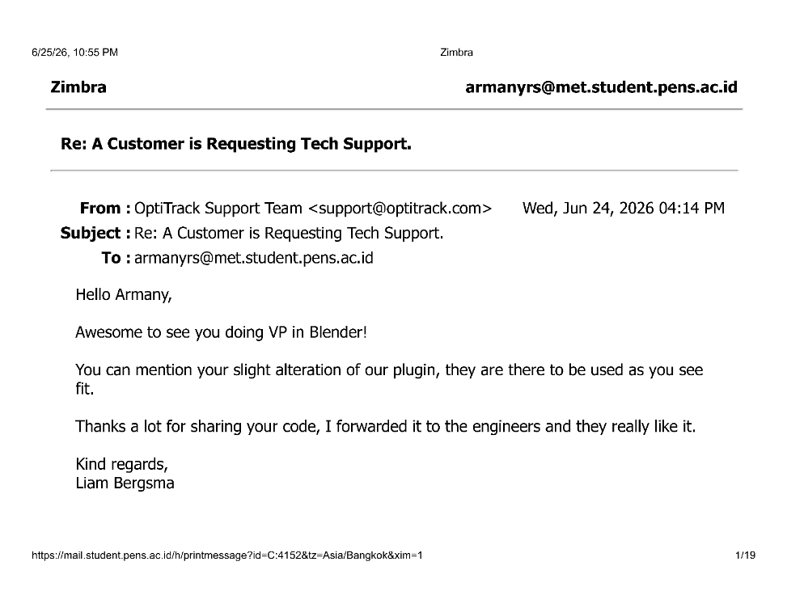

Halaman ini sengaja dikosongkan

**Lampiran 2** Modifikasi Kode Sumber dan Pull Request pada Repositori
OptiTrack

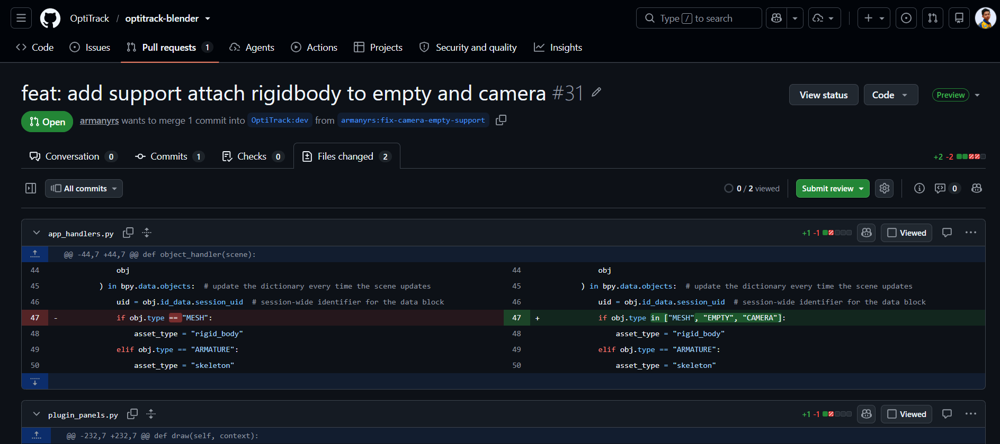

**\**

Halaman ini sengaja dikosongkan

**Lampiran 3** Transmisi Data Skeleton dari Optitrack Motive ke Blender

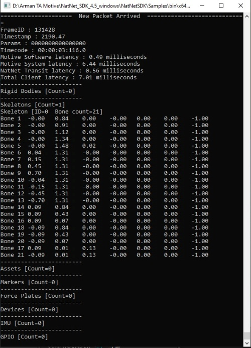

Halaman ini sengaja dikosongkan

**Lampiran 4** Transmisi Data Rigid Body dari Optitrack Motive ke
Blender

Halaman ini sengaja dikosongkan

**Lampiran 5** Biodata Penulis

